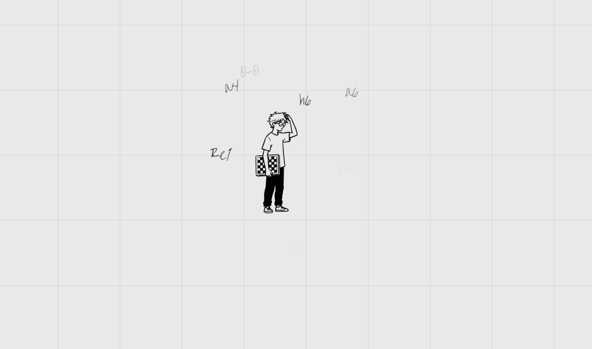
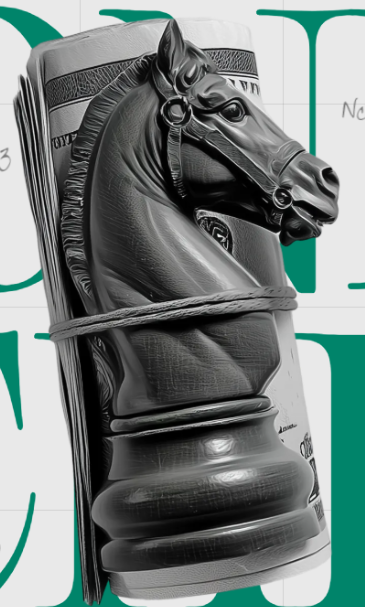
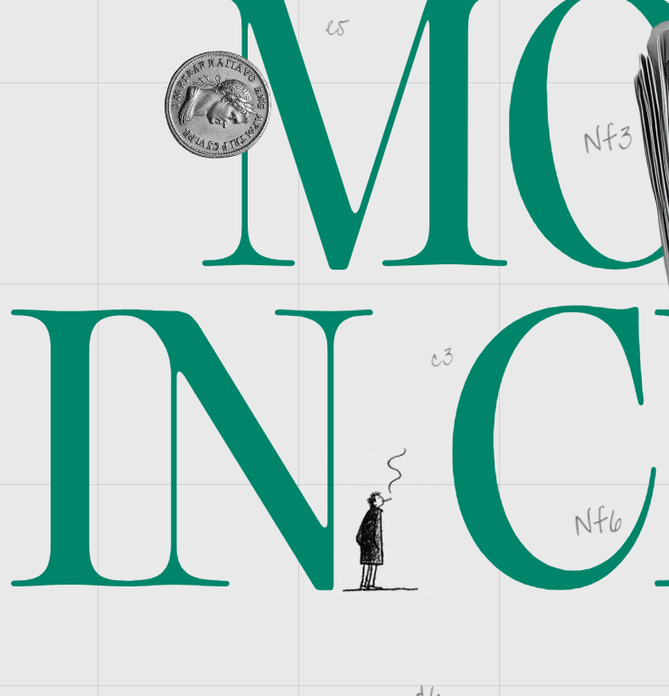
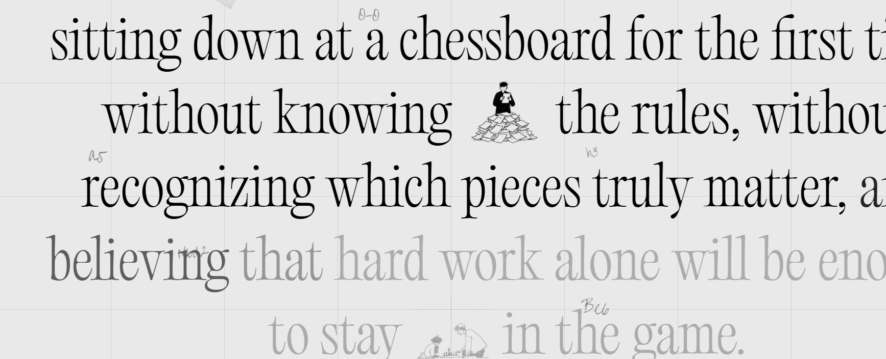
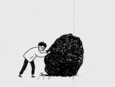
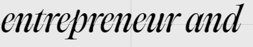
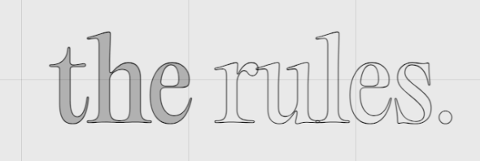
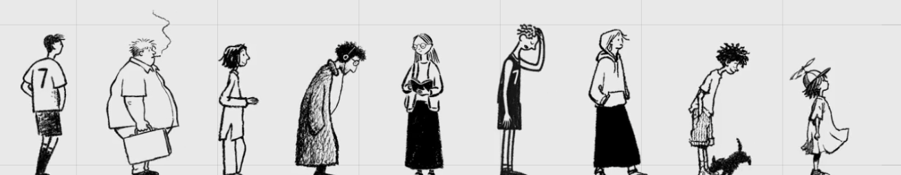
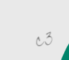

# Evidências visuais de estudo

Recortes das imagens fornecidas, não ativos de produção. Os arquivos foram extraídos
sem recriar o desenho. Não incluem as zonas de nomes, créditos ou retratos pessoais.
Dimensões e retângulos de extração estão em `manifest.json`.

## E01 — Personagem isolado, grid e espaço negativo.
Fonte local: S01. Raster do recorte: 1409 × 833 px.

## E02 — Objeto monocromático de aparência material.
Fonte local: S02. Raster do recorte: 365 × 607 px.

## E03 — Capitais, serifas, escala e pequeno desenho na baseline.
Fonte local: S03. Raster do recorte: 740 × 769 px.

## E04 — Narrativa, vinhetas e diferentes estados de tinta.
Fonte local: S04. Raster do recorte: 1735 × 705 px.

## E05 — Pequena cena em traço preto, com gesto e massa.
Fonte local: S05. Raster do recorte: 225 × 170 px.

## E06 — Recorte com dobras e aparência volumétrica.
Fonte local: S05. Raster do recorte: 410 × 410 px.

## E07 — Inflexão itálica no texto editorial.
Fonte local: S06. Raster do recorte: 360 × 68 px.

## E08 — Letras de contorno no encerramento.
Fonte local: S07. Raster do recorte: 590 × 198 px.

## E09 — Variação de personagens em uma baseline comum.
Fonte local: S07. Raster do recorte: 1310 × 256 px.

## E10 — Notação manuscrita de baixa intensidade.
Fonte local: S03. Raster do recorte: 100 × 87 px.

