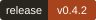
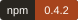
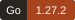
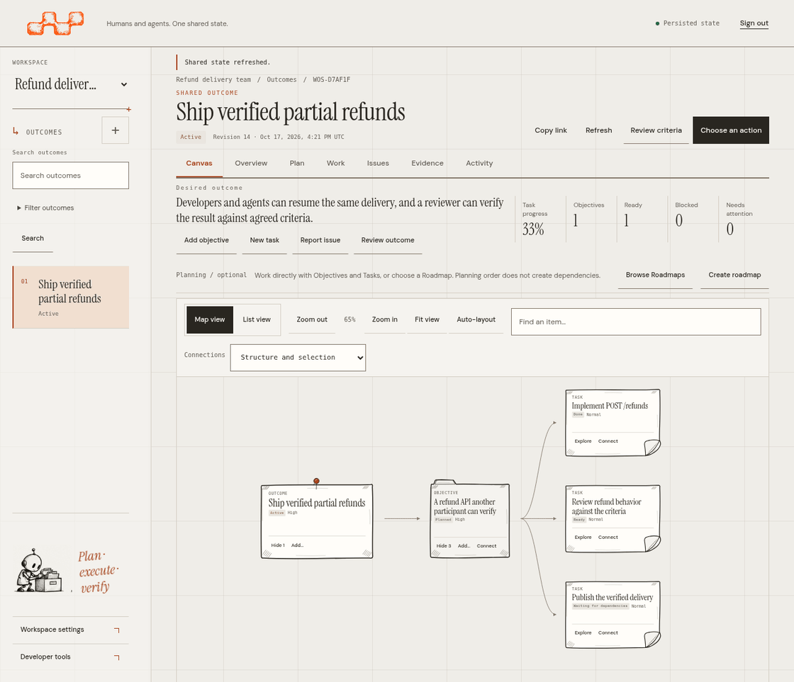
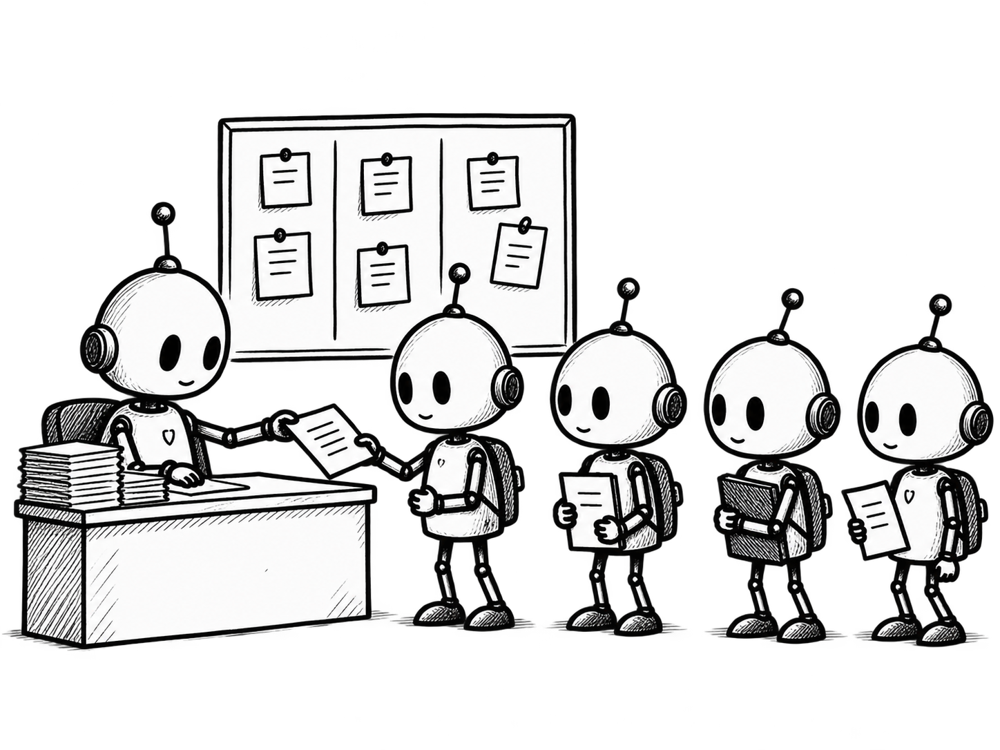

<p align="center">
  
</p>

<p align="center"><strong>Meaningful outcomes. Work together.</strong></p>

<p align="center">
  <a href="https://github.com/A1b3rt0M3rcad0/wos/releases/latest"></a>
  <a href="https://www.npmjs.com/package/wosctl"></a>
  <a href="https://github.com/A1b3rt0M3rcad0/wos/actions/workflows/ci.yml"></a>
  <a href=".go-version"></a>
  <a href="LICENSE"></a>
</p>

<p align="center">
  <a href="#how-it-works">Product tour</a> ·
  <a href="#why-use-it">Why use it</a> ·
  <a href="#concepts-in-one-minute">Concepts</a> ·
  <a href="#for-developers-and-oaas">Developers and OaaS</a> ·
  <a href="#quick-start">Quick start</a> ·
  <a href="#operate-with-agents">Agents</a> ·
  <a href="#project-status">Status</a> ·
  <a href="docs/README.md">Documentation</a>
</p>

**WOS (Work Outcome System) is the coordination layer for teams working with AI agents and companies embedding agents into their products.** You define the requested result and plan the work. WOS keeps the Tasks, dependencies, permissions, deliveries, Evidence and acceptance criteria in shared, persistent state across people, agents, tools and sessions.

When work spans several agents and conversations, agents can duplicate effort, lose context between sessions or report "done" without showing that the requested result was achieved. WOS makes the work visible: **what needs to happen, who is authorized to act, what is blocked, what was delivered and what still needs verification.**

- **For developers and teams:** coordinate people, coding agents and subagents around a shared goal. Give participants Tasks with clear scope, permissions and recorded context. Preserve progress between sessions and review deliveries alongside your repository and development tools.
- **For B2B SaaS and Outcome-as-a-Service (OaaS) builders:** embed persistent work coordination into your application. Represent customer requests as Outcomes, expose progress and track deliveries against agreed criteria while your own agents and workers perform the work.

**Completing a Task is not the same as achieving an Outcome.** WOS keeps execution, delivery, assessment and acceptance separate. Evidence supports verification; it does not automatically approve a criterion or prove that the result is correct.

Use the browser to plan and review, the CLI to coordinate external agents, or HTTP and MCP to integrate your product. Your runtime selects, schedules and runs agents. WOS persists shared state and enforces the rules for coordinating and accepting their work.

## How it works

Suppose your team needs to **ship partial refunds**. Define a success criterion: customers can receive part of a payment back, but never more than the amount still refundable. A coding agent implements the change and records the exact commit and test report. A person or an authorized reviewing agent checks that delivery against the criterion before the Outcome is explicitly accepted. If a session ends midway, the next participant can read the recorded progress and remaining work.

<p align="center">
  <a href="docs/images/workspace-tour.gif"></a>
</p>

The tour navigates sample records in the real application: **Canvas → Task details → Work → Evidence → Overview and criteria**. It shows a completed Task alongside criteria still awaiting assessment. Navigation does not execute the work or demonstrate a signed independent review. [Static view](docs/images/workspace-tour.png) · [Recording details](docs/images/workspace-tour.md) · [All desktop and mobile pages](docs/design/operational-canvas/workspace/README.md).

| Step | What you do | What stays recorded |
| --- | --- | --- |
| Define the result | Create an Outcome and its success criteria | What must be true before you accept the result |
| Plan the work | Add Tasks, optional Objectives and explicit dependencies | Who needs to do what, and what is blocked |
| Execute | A participant acquires a Task and works in their own tools | Bounded authority, instructions and reported progress |
| Deliver | Register the change, output and supporting material | The submitted version, Artifact references and Evidence |
| Review | Inspect the actual delivery and assess the applicable criteria | The review decision and its supporting observations |
| Conclude | Explicitly accept the Outcome when its requirements are satisfied | The basis for accepting the result |

When the Workspace policy requires independent review, the reviewer must be a different authenticated identity from the executor.

<details>
<summary>The shared-work metaphor</summary>

<p align="center">
  
</p>

The board represents shared state; each paper represents a bounded piece of work. The product tour above shows the actual interface.

</details>

## Why use it

| Problem | How WOS helps |
| --- | --- |
| Two agents try to take the same Task | One participant holds current authority at a time. Expiry and stale-claim checks protect recorded work. |
| An agent says "done," but nobody has checked the result | Keep delivery and assessment separate; require an eligible independent reviewer when the policy calls for one. |
| A session ends before the work is finished | The next participant can read the recorded instructions, progress and remaining work. |
| A request times out and you cannot tell whether it succeeded | Inspect its durable receipt and reconcile the original request instead of guessing or submitting a different operation. |
| People and agents work in different tools | The workspace, CLI, HTTP and MCP interfaces read and update the same state under the same rules. |

## Concepts in one minute

| Term | Meaning | Partial-refund example |
| --- | --- | --- |
| Outcome | The desired result, accepted explicitly | Customers can receive partial refunds |
| Success criterion | A revisioned condition that must be assessed | Refunds above the remaining amount are rejected |
| Objective | An optional intermediate condition | Refund behavior is implemented and verified |
| Task | Concrete work for a participant; `WorkItem` in the API | Implement amount validation |
| Contract | Bounded authority issued at checkout in a contract-enabled Workspace | Permission to deliver one Task under the issued constraints |
| Artifact / Evidence | A deliverable reference, and an observation or source used to check it | An exact commit, and the recorded validation test report |
| Assessment / Conclusion | Evaluation of a criterion, and the basis for accepting the result | The amount check passed; accept the Outcome after all requirements are satisfied |
| Workspace / Namespace | The same access boundary: Workspace in the UI, Namespace in API/CLI configuration | The team's authorized space |

A Roadmap is an optional versioned plan referencing existing Objectives and Tasks. Publishing it does not execute work or create dependencies automatically.

## For developers and OaaS

### Coordinate a development team

Keep your repository, coding agents and CI. For the partial-refund example, define implementation, testing and review Tasks, with explicit dependencies where one must wait for another. Agents such as Codex or Claude Code acquire authorized work through the CLI, use their existing tools, and record progress and delivery references. Your team uses the workspace to inspect blockers, review test reports and decide whether the result meets the agreed criteria.

### Embed coordination in a SaaS or OaaS product

In an **Outcome-as-a-Service (OaaS)** product, a customer requests an agreed result, such as a verified software change or a reviewed report. Your application records that request as an Outcome, defines the work and criteria, and presents progress to the customer. Your agents and workers produce the deliverables; authorized reviewers assess them.

For example, a finance SaaS could accept "prepare this month's reconciliation report," create Tasks to collect records and investigate discrepancies, and require review before accepting the report. WOS records the work and its verification history. You build and operate the customer-facing service.

| Your product or runtime owns | WOS provides |
| --- | --- |
| Customer intake and agreement on the requested result | Outcomes, success criteria, Objectives and Tasks |
| Agent selection, scheduling, tools and execution | Explicit work acquisition, scoped authority and current obligations |
| Producing deliverables and inspecting their contents | Artifact references, Evidence, assessments and explicit conclusions |
| Customer access, provisioning, pricing and billing | Namespace authorization boundaries, recorded state, history and integration events |

Provision credentials and grants for each integration; a customer ID in metadata does not grant access. Webhooks report recorded changes with at-least-once delivery. Your consumer verifies and deduplicates them before deciding what to do next. See [security boundaries](SECURITY.md) and [events and webhooks](docs/integration-events.md).

The license permits delivering your application's functionality or outcomes. Reselling WOS itself or charging for access to a WOS platform or instance is excluded, regardless of the brand used. See [license and brand](#license-and-brand).

### Choose an interface

| Interface | Use it for | Start here |
| --- | --- | --- |
| Browser workspace | Human planning, Canvas navigation, review and inspection | [Workspace guide](docs/workspace-ux.md) |
| Native CLI and five Skills | Coding agents acquiring work, recording progress and returning deliveries | [Agent guide](docs/agents.md) |
| HTTP API and remote Go client | Connecting a service, customer portal, job or integration | [HTTP API](docs/http.md) · [Client example](examples/remote-client) |
| MCP | Exposing authorized coordination tools to an MCP client | [MCP contracts](docs/contracts.md) |
| Public Go Core | Embedding the domain and application services in a Go host | [Architecture](docs/architecture.md#packages-and-interfaces) |

Official agent Skills operate through the CLI. MCP and HTTP are additional integration interfaces. An embedded host is responsible for its authentication and authorization boundaries; see [deployment modes](docs/operations.md).

## Quick start

### Run the current workspace

You need Git, Docker and Docker Compose v2. The server path below builds the current `master` source, including the interface shown in the tour.

```sh
git clone --branch master https://github.com/A1b3rt0M3rcad0/wos.git
cd wos
cp .env.example .env
docker compose up --build -d
```

**You should see:** the login page at **http://127.0.0.1:8080/app/**. Copy `WOS_BOOTSTRAP_TOKEN` from `.env` into **Access credential**, then choose **Sign in**. The unchanged example opens the **Main** Workspace.

> [!WARNING]
> The example contains a public development credential. Keep it on localhost. Before sharing a deployment, configure private credentials, permissions and HTTPS using the [shared-service guide](docs/operations.md#shared-service). Do not print credentials in logs.

Create an Outcome with **+** beside **Outcomes**. Add a required success criterion and a Task, then explicitly activate the Outcome when preparation is ready. Inspect the work in **Canvas**, **Work** and **Evidence**. **Choose an action** exposes the operations your permissions and the current state allow. A new installation starts with your own records, not the tour's sample data.

<a id="requirements-and-platforms"></a>
<details>
<summary>Requirements, platforms and troubleshooting</summary>

| Component | Supported path |
| --- | --- |
| Server | Linux amd64, including the published container |
| Native CLI | Linux x64 and Windows x64 release archives |
| macOS / ARM | No qualified native CLI distribution; use a browser with a supported server. Container emulation is not qualified. |
| npm launcher | Node.js 22+; native archives do not need Node.js |
| Database | SQLite for local use; PostgreSQL for shared deployments |
| Source build | Stable Go 1.27.2, pinned in [.go-version](.go-version) |

| Symptom | Check |
| --- | --- |
| Port 8080 is occupied | Run `WOS_HTTP_PORT=8081 docker compose up --build -d`, then open port 8081. |
| Docker reports permission denied or cannot connect | Start Docker and use its supported user-access setup. Check `docker info` before retrying. |
| Sign-in rejects the credential | Copy the whole value from the `.env` used for first initialization. Changing the bootstrap value does not reset an existing credential; follow [credential recovery](docs/getting-started.md#sign-in-and-persisted-data). |

For startup failures, inspect `docker compose logs --tail=100 wos`. [Service lifecycle, backups, source builds and setup help](docs/getting-started.md).

</details>

Want an executable example before configuring agents? The [isolated local lifecycle](examples/quickstart/README.md) creates one Outcome, delivers a file, assesses a criterion and concludes the result. It uses one trusted operator and the unsigned API; it does not demonstrate independent review.

## Operate with agents

> [!NOTE]
> The published image and `wosctl@0.4.2` predate the current workspace and centralized agent commands. Build this source for the flow below. For the published version, follow [its tagged README](https://github.com/A1b3rt0M3rcad0/wos/blob/v0.4.2/README.md) or [try its prebuilt container](docs/getting-started.md#published-container).

Build the CLI from the repository root with stable Go 1.27.2, then install its instruction files in your external agent:

```sh
go build -o bin/wos ./packages/wos-api/cmd/wos
./bin/wos init
./bin/wos skill install --agent codex
```

Use `claude`, `hermes`, `openclaw` or `all` for the other supported layouts. The five Skills guide workspace operation, coordination, delegation, continuity and review. They install instructions; they do not start an agent or grant access.

An administrator must [provision approved Profiles](docs/signed-workspace-profiles.md#provision-an-approved-identity), credentials and signing identities, and enable the appropriate Workspace protocol. After provisioning, an executor can acquire work and read its context from any directory:

```sh
./bin/wos --profile executor work available
./bin/wos --profile executor work next
./bin/wos --profile executor work context
```

The agent performs the work in its own tools, then records actual progress, Artifact references and Evidence through typed CLI commands. `work check` reports readiness and obligations; `work finish` signs, submits and reconciles the delivery. Delivery alone is not approval. Where independent review is required, another eligible Principal inspects the exact submission and records its decision and criterion assessments.

Profiles keep destinations and protected local state separate. Concurrent agents pin `--profile` on every invocation. After an uncertain response, use the CLI's recovery commands to reconcile the original request; preserve pending material. Two Profile names do not establish two independent identities.

Follow the [complete agent workflow](docs/agents.md) for recording proof, review and recovery. [CLI reference](packages/wos-cli/README.md) · [Protected Profiles](docs/signed-workspace-profiles.md) · [Signed return safety](docs/signed-cli-returns.md).

## Fit and limits

Use a checklist or issue tracker when human conventions are enough. Add this service when participants need machine-readable authority, delivery, review and recovery rules across tools. Keep Jira or Linear for the reporting they provide, and keep your agent framework for runtime orchestration; integrations remain your responsibility.

The server checks recorded authority and state. It cannot prove that claimed external execution happened. Reviewers must inspect the actual material, and Task acquisition does not lock your Git branch or filesystem. See [security boundaries](SECURITY.md).

## License and brand

Current source is available under the [WOS Sustainable Use License 1.0](LICENSE). You may self-host it in production, modify it privately, use it as infrastructure for commercial applications and OaaS products, and charge for genuine technical services on a customer's own permitted deployment.

**You may not sell the WOS platform, supply paid access to a hosted or managed instance, or commercially white-label, rebrand or OEM-supply the platform.** The restriction applies under the WOS brand and under any other name, including paid bundles. Your own application's functionality and outcomes remain permitted within the license.

The [trademark policy](TRADEMARKS.md) permits ordinary installation identification and truthful descriptive references. It grants no right to market the platform as your own or imply official representation. See the [licensing guide](docs/licensing.md) for examples and distribution obligations.

Previously granted Apache-2.0 rights and third-party licenses remain effective for the material they cover. The new terms do not retroactively change published copies. [Notices and earlier grants](NOTICE.md).

## Project status

| Item | State |
| --- | --- |
| Published baseline | [v0.4.2](https://github.com/A1b3rt0M3rcad0/wos/releases/tag/v0.4.2), also available as `wosctl@0.4.2` and on GHCR |
| This README and tour | Describe current source, including changes not yet published in that release |
| Compatibility | Existing HTTP/CLI contracts and checked forward migrations follow the [compatibility policy](docs/stable/compatibility.md); no blanket 1.0 certification |
| Stable 1.0 acceptance | Tracked separately in [ROADMAP.md](ROADMAP.md) |

## Documentation and support

- [Documentation index](docs/README.md): setup, workspace use, agents and integration references.
- [Workspace gallery](docs/design/operational-canvas/workspace/README.md) and [Canvas guide](docs/design/operational-canvas/README.md): pages, forms, mobile states and interaction details.
- [Server operations](docs/operations.md), [architecture](docs/architecture.md) and [operational acceptance](docs/stable/operational-acceptance.md).
- [Report bugs or ask questions](https://github.com/A1b3rt0M3rcad0/wos/issues): include versions and a minimal reproduction, without secrets.
- [Contribute](CONTRIBUTING.md) or [report a security concern](SECURITY.md#report-a-vulnerability).

[Release process](docs/releases.md) · [Source-available license](LICENSE)
