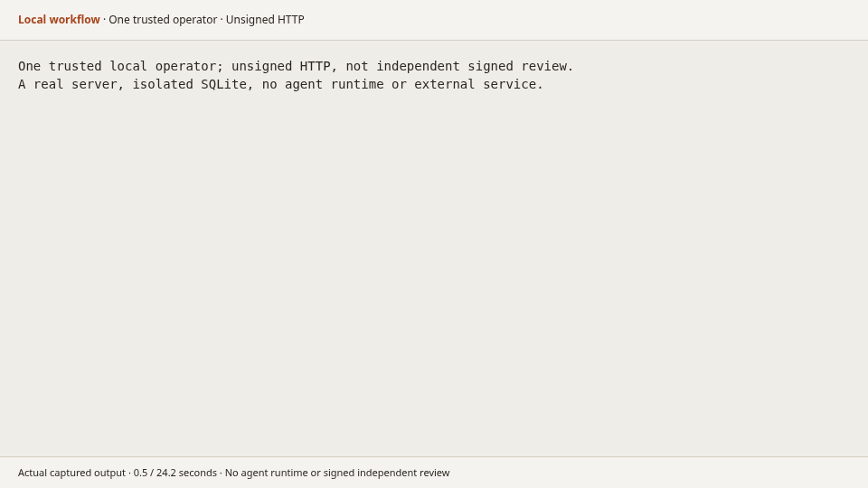

<p align="center">
  
</p>

<p align="center"><strong>Meaningful outcomes. Work together.</strong></p>

<p align="center">
  <a href="https://github.com/A1b3rt0M3rcad0/wos/releases/latest"></a>
  <a href="https://www.npmjs.com/package/wosctl"></a>
  <a href="https://github.com/A1b3rt0M3rcad0/wos/actions/workflows/ci.yml"></a>
  <a href=".go-version"></a>
  <a href="LICENSE"></a>
</p>

<p align="center">
  <a href="#why-use-it">Why use it</a> ·
  <a href="#concepts-in-one-minute">Concepts</a> ·
  <a href="#how-it-works">Demo</a> ·
  <a href="#quick-start">Quick start</a> ·
  <a href="#operate-with-agents">Agents</a> ·
  <a href="#project-status">Status</a> ·
  <a href="docs/README.md">Documentation</a>
</p>

For teams using coding agents such as Codex or Claude Code on work that spans several sessions. An agent delivers a Task; a person or another agent checks the actual material against agreed criteria before accepting the result. If a session stops, the next participant reads the recorded work and continues.

The server stores that history and enforces coordination rules. Your tools execute the work. It does not run agents, schedule them, or act as an agent framework. Independent review is enforced when the Workspace's review policy requires it.

## Why use it

| When this happens                                            | What changes in practice                                                                                                       |
| ------------------------------------------------------------ | ------------------------------------------------------------------------------------------------------------------------------ |
| Two agents try to take the same Task                         | The server grants one current acquisition at a time, with an expiry and checks that reject stale deliveries.                   |
| An agent says "done," but nobody has checked the result      | Keep the delivery and criterion assessments separate; require another eligible identity when independent review is configured. |
| A session ends and its context disappears                    | The next participant reads the recorded instructions, progress, and remaining work.                                            |
| A request times out and you cannot tell whether it succeeded | Inspect its durable receipt before reconciling the original request, rather than submitting a different operation.             |
| People and agents use different tools                        | The browser, CLI, HTTP, and MCP interfaces use the same persisted state and rules.                                             |

<p align="center">
  
</p>

The real **Work** area, with illustrative records. Switch between a list and board while keeping the Outcome, its Tasks, and their current state together.

<details>
<summary>See the Evidence area</summary>


Evidence supplies material for assessment; adding it does not accept a result. [Desktop and mobile gallery](docs/design/editorial/README.md#main-pages).

</details>

## Concepts in one minute

| Term                  | Meaning                                                                                     | Example                                                     |
| --------------------- | ------------------------------------------------------------------------------------------- | ----------------------------------------------------------- |
| Outcome               | The desired result, with success criteria                                                   | "Installation instructions are ready for review"            |
| Objective             | An optional intermediate condition                                                          | "Installation and verification commands documented"         |
| Task                  | A concrete action for a participant; `WorkItem` in the API                                  | "Write the installation guide"                              |
| Contract              | Bounded authority issued when a participant checks out work in a contract-enabled Workspace | Permission to deliver this Task before the contract expires |
| Evidence              | Material used to check a claim                                                              | The generated `installation.md` guide                       |
| Assessment            | An explicit evaluation of a criterion                                                       | Check that the guide includes both required commands        |
| Conclusion            | An explicit decision accepting a result                                                     | Achieve the Outcome after its required criteria are met     |
| Workspace / Namespace | The same access boundary: **Workspace** in the UI, **Namespace** in API/CLI configuration   | The team's shared space                                     |

A Roadmap is an optional versioned plan linking Objectives and Tasks. **Completing a Task does not automatically achieve its Outcome. Evidence does not approve a result.**

## How it works

<p align="center">
  
</p>

_Conceptual metaphor: the board is shared state, and each paper is a bounded piece of work. The screenshots above show the actual product._

Try a small example: prepare an installation guide, acquire its Task, deliver the file, assess whether it includes the required commands, and explicitly conclude the Outcome.



This short recording runs real commands against an isolated local server. One trusted operator performs the unsigned walkthrough; it does **not** demonstrate signed independent review. [Replay data and runnable example](examples/quickstart/README.md).

With a binary from this source and Python 3.9 or later:

```sh
python3 examples/quickstart/demo.py --binary ./bin/wos
```

The example starts its own loopback server and uses separate temporary data. See its guide for expected output, retained files, and cleanup. [Build the source binary](docs/getting-started.md#build-from-source) if you do not have it yet.

## Quick start

### Requirements and platforms

| Component       | Supported path                                                                                                     |
| --------------- | ------------------------------------------------------------------------------------------------------------------ |
| Server          | Linux amd64, including the published container                                                                     |
| Native CLI      | Linux x64 and Windows x64 release archives                                                                         |
| macOS / ARM     | No qualified native CLI distribution; use a browser with a supported server. Container emulation is not qualified. |
| npm launcher    | Node.js 22+; native archives do not need Node.js                                                                   |
| Database        | SQLite for local use; PostgreSQL for shared deployments                                                            |
| Source build    | Stable Go 1.27.2, pinned in [.go-version](.go-version)                                                             |
| Container setup | Docker; Docker Compose v2 and Git for the source path below                                                        |

> [!NOTE]
> Screenshots and source examples describe this branch. The published **0.4.2** image and npm package have an earlier interface. Use the source path for the workspace shown above, or [try the prebuilt release without Git](docs/getting-started.md#published-container).

### Run the workspace shown here

```sh
git clone --branch design/editorial-robot-workspace https://github.com/A1b3rt0M3rcad0/wos.git
cd wos
cp .env.example .env
docker compose up --build -d
```

**You should see:** the login page at **http://127.0.0.1:8080/app/**. Copy the `WOS_BOOTSTRAP_TOKEN` value from `.env` into **Access credential**, then choose **Sign in**. The unchanged example works without editing and opens the **Main** Workspace.

> [!WARNING]
> The example contains a public development credential. Keep it on localhost. Before sharing a deployment, configure private credentials, permissions, and HTTPS using the [shared-service guide](docs/operations.md#shared-service). Do not print credentials in logs.

<details>
<summary>Preview the login page</summary>


This is the source branch's interface; published 0.4.2 looks different.

</details>

Create an Outcome with **+** beside **Outcomes**, add a required success criterion, and save a Task in **Work**. Activate the Outcome explicitly when preparation is ready. Use **Evidence** to record delivery material and **Choose an action** for the operations your permissions and current state allow. The [workspace guide](docs/workspace-ux.md) explains all six areas.

### Troubleshooting

| Symptom                                            | Check                                                                                                                                                                                                                     |
| -------------------------------------------------- | ------------------------------------------------------------------------------------------------------------------------------------------------------------------------------------------------------------------------- |
| Port 8080 is occupied                              | Run `WOS_HTTP_PORT=8081 docker compose up --build -d`, then open port 8081.                                                                                                                                               |
| Docker reports permission denied or cannot connect | Start Docker and use its supported user-access setup. Check `docker info` before retrying.                                                                                                                                |
| Sign-in rejects the credential                     | Copy the whole value from the `.env` used for first initialization. Changing the bootstrap value does not reset an existing credential; follow [credential recovery](docs/getting-started.md#sign-in-and-persisted-data). |

For startup failures, inspect `docker compose logs --tail=100 wos`. [Service lifecycle, backups, source builds, and further setup help](docs/getting-started.md).

## Operate with agents

> [!NOTE]
> npm installs the published release, not this branch. Check [its tagged README](https://github.com/A1b3rt0M3rcad0/wos/blob/v0.4.2/README.md) for that version. Build this source when following a branch-only example.

### Install the CLI

```sh
npm install -g wosctl@0.4.2
wos version
```

The `wosctl` package supplies the native `wos` command. `wosctl` remains a compatibility executable alias. You can use a [native archive](https://github.com/A1b3rt0M3rcad0/wos/releases/tag/v0.4.2) instead of npm.

### Install skills in your agent

| Agent                      | Command                                                            |
| -------------------------- | ------------------------------------------------------------------ |
| Codex                      | `wos skill install --agent codex`                                  |
| Claude Code                | `wos skill install --agent claude`                                 |
| Hermes                     | `wos skill install --agent hermes`                                 |
| OpenClaw                   | `wos skill install --agent openclaw`                               |
| All four                   | `wos skill install --agent all`                                    |
| Custom discovery directory | `wos skill install --agent generic --dir /absolute/path/to/skills` |

Installation is offline and preserves local modifications. The five skills cover different jobs:

| Skill        | Guides the agent to                                             |
| ------------ | --------------------------------------------------------------- |
| Coordination | Acquire bounded authority and deliver material                  |
| Delegation   | Delegate through the host's authorized subagents                |
| Continuity   | Resume using recorded specifications, checkpoints, and receipts |
| Review       | Evaluate the exact submission and applicable criteria           |
| Workspace    | Manage local drafts and recover unfinished operations           |

> [!IMPORTANT]
> Installing skills adds instruction files. Configure the agent runtime, API/MCP connection, credentials, and Workspace protocol separately; installation grants no authority and starts no agent.

### Basic workflow

Start with the [unsigned local example](examples/quickstart/README.md). For your own Workspace, read current context, acquire the authority required by its protocol, execute in your own tools, deliver material, and assess the applicable criteria. Conclude accepted results explicitly.

### Signed execution and recovery

For a provisioned signed Workspace, [the agent guide](docs/agents.md#3-acquire-and-execute-work) separates checkout, context inspection, external execution, delivery, independent review, and exact-intent recovery. [Profile setup](docs/signed-workspace-profiles.md) covers identities and protected keys; it is required before those commands work.

<details>
<summary>Preview the context an agent receives</summary>

After configured checkout, inspect the returned contract ID:

```sh
wos --profile executor work show CONTRACT_UUID --for-agent --output json
```

Illustrative excerpt of that response; fields are omitted and values vary:

```json
{
  "operation": "work show",
  "committed": false,
  "data": {
    "specification": {
      "title": "Write the installation guide",
      "acceptance_floor": "independent_review",
      "policy_revision": "1"
    },
    "status": {
      "effective_status": "active",
      "lease_valid": true
    }
  }
}
```

The issued specification states what may be delivered; status reports current authority. A local file does not renew an expired contract. Follow the full [execution and recovery guide](docs/agents.md).

</details>

## When to use it

| Your current tool                             | Keep it when                                   | Add shared coordination when                                                                                  |
| --------------------------------------------- | ---------------------------------------------- | ------------------------------------------------------------------------------------------------------------- |
| Markdown files and issues                     | A checklist and human conventions are enough   | You need explicit acquisition, stale-write checks, durable receipts, and criterion history across tools       |
| Jira or Linear                                | Your main need is human planning and reporting | Agents need machine-readable authority, delivery, and recovery rules; integration remains your responsibility |
| LangGraph, CrewAI, or another agent framework | You need an agent runtime and orchestration    | You want external persisted coordination; the framework still executes and schedules work                     |

The server checks recorded authority and state. It cannot prove that an agent's claimed external execution happened; reviewers must inspect the evidence. A Task acquisition does not lock your Git branch or filesystem. See [security boundaries](SECURITY.md).

## Integrate and learn more

Use the [HTTP API](docs/http.md), [MCP](docs/contracts.md), [native CLI](packages/wos-cli/README.md), or [Go Core and client](docs/architecture.md#packages-and-interfaces). [Events and webhooks](docs/integration-events.md) let an external consumer react to recorded changes.

- [Documentation index](docs/README.md), [server operations](docs/operations.md), and [architecture](docs/architecture.md).
- [Report bugs or ask questions](https://github.com/A1b3rt0M3rcad0/wos/issues); include versions and a minimal reproduction, without secrets.
- [Contribute](CONTRIBUTING.md): setup, tests, and review expectations.
- [Report security concerns](SECURITY.md#report-a-vulnerability): request a private channel before sharing sensitive details.

## Project status

| Item                  | State                                                                                                                                                    |
| --------------------- | -------------------------------------------------------------------------------------------------------------------------------------------------------- |
| Published baseline    | [v0.4.2](https://github.com/A1b3rt0M3rcad0/wos/releases/tag/v0.4.2), also available as `wosctl@0.4.2` and on GHCR                                        |
| This README           | Describes this branch, including unreleased interface changes                                                                                            |
| Compatibility         | Existing HTTP/CLI contracts and checked forward migrations follow the [compatibility policy](docs/stable/compatibility.md); no blanket 1.0 certification |
| Stable 1.0 acceptance | Tracked separately in [ROADMAP.md](ROADMAP.md)                                                                                                           |

[Release process](docs/releases.md) · [Operational acceptance and measured limits](docs/stable/operational-acceptance.md) · [Apache 2.0 license](LICENSE)
