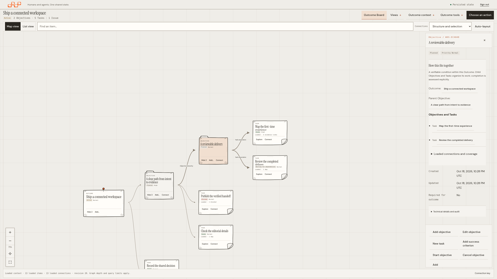
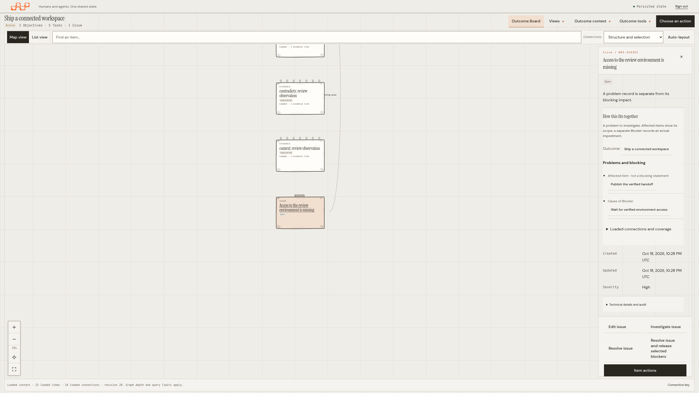
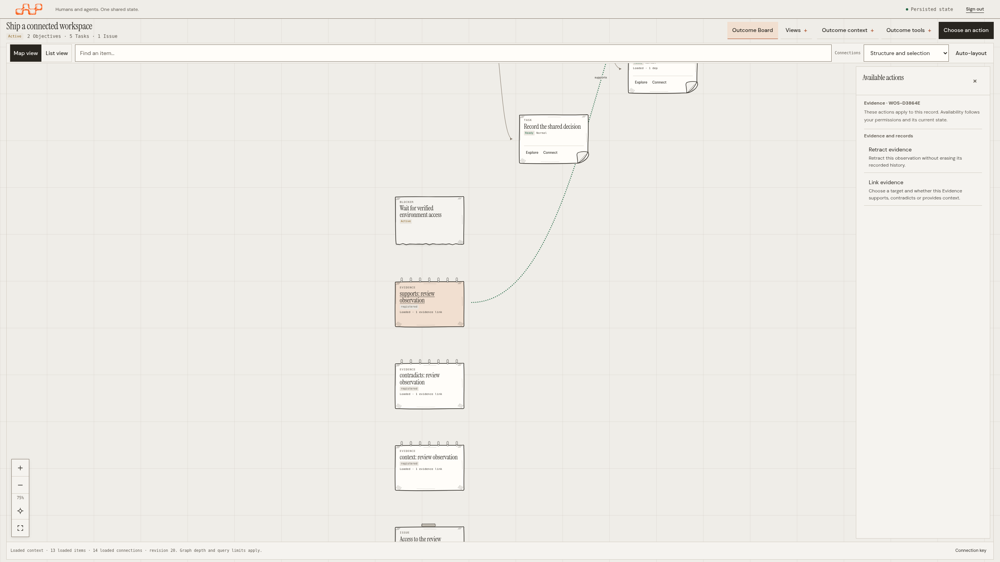
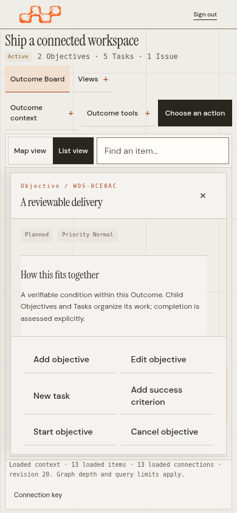
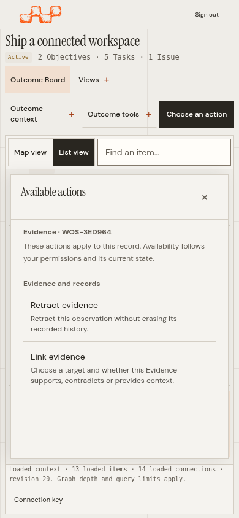
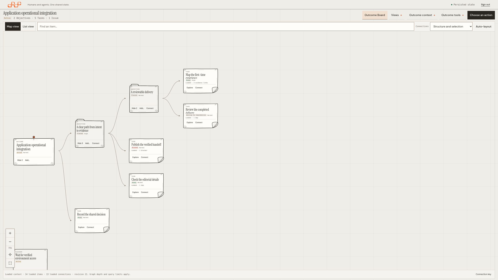

# Board relationships and contextual actions

These 33 captures show implementation source
[`c394f13`](https://github.com/A1b3rt0M3rcad0/wos/tree/c394f13801a7ca56900da334a862f917fed43aa8) in draft
[PR #116](https://github.com/A1b3rt0M3rcad0/wos/pull/116). The interface retains
its stable operational sizes, editorial typography and original paper artwork.

## Read the work, then act in context

The inspector explains what the selected record means, where it belongs and
which actual loaded records connect to it. Objectives and Tasks, dependencies,
Evidence stances, affected items and explicit Blockers use distinct labels.
Links open the persisted record. Longer groups disclose additional loaded
connections; their coverage remains explicit.





**Choose an action** operates on the Outcome. **Item actions** operates on the
selected record. Both identify that context before grouped, naturally sized
rows. Each explanatory line describes the actual consequence. Dismissing a
global menu preserves the selected card and its own command scope.



| Mobile relationships | Mobile actions |
| --- | --- |
|  |  |

[Practical relationship guide](../../../workspace-relationships.md) ·
[Stable sizing decisions](../operational-density.md)

## Feedback and navigation

Map completeness stays in the Board footer next to **Load more map items**.
Other feedback uses the original live region in a separate normal-flow row,
outside the map and inspector. Errors remain visible when an Outcome or
Workspace transition fails, including when the previous Board is hidden.

Cards can be placed on every side of the original origin. Scrolling or
trackpad movement pans the map; **Ctrl/Command + scroll** zooms at the pointer.
Center and Fit follow the actual signed card extents, preserving connection
geometry. Local placement changes no ownership, dependencies, server state or
record-loading limits.



## Verification

- All **57 unit checks** and **122 real-browser journeys** pass in one clean
  full run, with no failures, skips, retries or flaky results.
- New regression journeys cover negative and positive card arrangements,
  refresh/resize stability, signed SVG links and hit targets, wheel/keyboard
  navigation, inspector/native scrolling, compact menus, actual command scope,
  unobscured feedback and failed context transitions.
- Relationship journeys traverse Objective → Task → Evidence → EvidenceLink,
  Issue → affected Task → Blocker → cause, without unintended writes.
  Delayed bounded graph expansion updates the inspector while preserving
  focused references and open disclosures.
- Existing navigation, races, permissions, native forms, signed authority and
  uncertain-response recovery remain covered. Native web tests/vet and all
  **16 release/compatibility checks** pass.
- Desktop, mobile and short-window coverage includes CSS widths 320–5120 px.
  Captures include 1280 × 720, QHD, 4K, 320/390 px mobile and CSS 2048 × 1152
  at DPR 1.25. Native Chromium 125%/150% zoom captures retain their original
  1366 × 768 framebuffer.

The [manifest](screenshots.json) records implementation source, binary/browser,
asset/test and screenshot hashes, individual served-asset comparisons and
measured viewport geometry. The [earlier density qualification](../density/README.md)
retains its own historical source. These local Chromium checks do not claim
representative-user acceptance or qualification of other browser engines.

## All captures

| State | CSS viewport | DPR |
| --- | --- | --- |
| [board-1280x720-inspector](screenshots/board-1280x720-inspector.png) | 1280 × 720 | 1 |
| [board-1280x720-map](screenshots/board-1280x720-map.png) | 1280 × 720 | 1 |
| [board-2048x1152-dpr1.25-inspector](screenshots/board-2048x1152-dpr1.25-inspector.png) | 2048 × 1152 | 1.25 |
| [board-2560x1440-inspector](screenshots/board-2560x1440-inspector.png) | 2560 × 1440 | 1 |
| [board-2560x1440-map](screenshots/board-2560x1440-map.png) | 2560 × 1440 | 1 |
| [board-320x740-inspector](screenshots/board-320x740-inspector.png) | 320 × 740 | 1 |
| [board-3840x2160-inspector](screenshots/board-3840x2160-inspector.png) | 3840 × 2160 | 1 |
| [board-3840x2160-map](screenshots/board-3840x2160-map.png) | 3840 × 2160 | 1 |
| [board-390x844-inspector](screenshots/board-390x844-inspector.png) | 390 × 844 | 1 |
| [board-390x844-map](screenshots/board-390x844-map.png) | 390 × 844 | 1 |
| [empty-workspace-1280x720](screenshots/empty-workspace-1280x720.png) | 1280 × 720 | 1 |
| [empty-workspace-2560x1440](screenshots/empty-workspace-2560x1440.png) | 2560 × 1440 | 1 |
| [empty-workspace-320x740](screenshots/empty-workspace-320x740.png) | 320 × 740 | 1 |
| [login-320x740](screenshots/login-320x740.png) | 320 × 740 | 1 |
| [login-390x844](screenshots/login-390x844.png) | 390 × 844 | 1 |
| [overview-1280x720](screenshots/overview-1280x720.png) | 1280 × 720 | 1 |
| [overview-2048x1152-dpr1.25](screenshots/overview-2048x1152-dpr1.25.png) | 2048 × 1152 | 1.25 |
| [overview-2560x1440](screenshots/overview-2560x1440.png) | 2560 × 1440 | 1 |
| [overview-320x740](screenshots/overview-320x740.png) | 320 × 740 | 1 |
| [overview-3840x2160](screenshots/overview-3840x2160.png) | 3840 × 2160 | 1 |
| [overview-390x844](screenshots/overview-390x844.png) | 390 × 844 | 1 |
| [task-form-2560x1440](screenshots/task-form-2560x1440.png) | 2560 × 1440 | 1 |
| [task-form-390x844](screenshots/task-form-390x844.png) | 390 × 844 | 1 |
| [canvas-native-zoom-125-inspector](screenshots/canvas-native-zoom-125-inspector.png) | 1093 × 614 | 1.25 |
| [canvas-native-zoom-125](screenshots/canvas-native-zoom-125.png) | 1093 × 614 | 1.25 |
| [canvas-native-zoom-150-inspector](screenshots/canvas-native-zoom-150-inspector.png) | 911 × 512 | 1.5 |
| [canvas-native-zoom-150](screenshots/canvas-native-zoom-150.png) | 911 × 512 | 1.5 |
| [relationships-2560x1440-actions](screenshots/relationships-2560x1440-actions.png) | 2560 × 1440 | 1 |
| [relationships-2560x1440-issue](screenshots/relationships-2560x1440-issue.png) | 2560 × 1440 | 1 |
| [relationships-2560x1440-objective](screenshots/relationships-2560x1440-objective.png) | 2560 × 1440 | 1 |
| [relationships-390x844-actions](screenshots/relationships-390x844-actions.png) | 390 × 844 | 1 |
| [relationships-390x844-issue](screenshots/relationships-390x844-issue.png) | 390 × 844 | 1 |
| [relationships-390x844-objective](screenshots/relationships-390x844-objective.png) | 390 × 844 | 1 |

## Reproduce

Build the embedded server from this source before running browser tests:

```sh
go build -trimpath -buildvcs=false \
  -ldflags "-X github.com/A1b3rt0M3rcad0/wos/packages/wos-api/internal/server.Commit=$(git rev-parse HEAD)" \
  -o bin/wos ./packages/wos-api/cmd/wos
cd tests/web
npm ci
WOS_CAPTURE_DENSITY=/tmp/wos-board-final-rich \
WOS_CAPTURE_CANVAS_FIRST=/tmp/wos-board-final-layout \
WOS_CAPTURE_BOARD_COMMUNICATION=/tmp/wos-board-final-relationships \
PLAYWRIGHT_JSON_OUTPUT_NAME=/tmp/wos-board-final-results.json \
  npm test -- --workers=3 --reporter=line,json
```

Set `WOS_TEST_CHROMIUM_PATH` to select an installed full Chromium. Native zoom
uses isolated profiles and Chrome's Settings API. Preparing or queuing a
release does not publish it; this PR remains draft until explicitly advanced.
