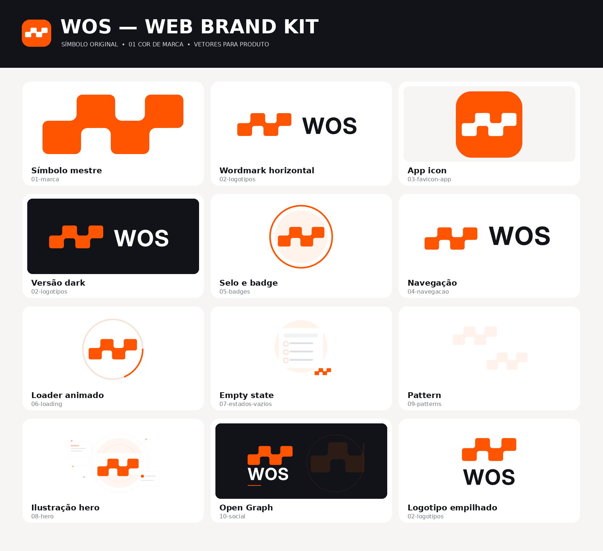

# WOS web identity integration

The owner supplied `WOS_Web_Brand_Kit.zip` as the WOS brand. This integration adopts its modular symbol and vector wordmark while retaining the approved editorial composition, robot illustrations, and Woobe operational palette.

## What the kit establishes

- A single master silhouette with a 194 × 82 aspect ratio. The same path data appears in all 80 supplied SVGs; each application supplies its own placement transform and viewBox.
- Brand orange `#FF5500`, consistent with the existing brand token. It identifies the WOS mark, separately from the interaction copper `#A7441D`.
- Light/dark, monochrome, browser icon, navigation, social, pattern, illustration, and loading assets.
- The kit describes the wordmark lockups as web proposals with Inter Display Bold converted to paths. The supplied horizontal Light version is adopted here as a provided vector lockup; this does not declare Inter an independently certified UI font. Instrument Serif and DM Sans remain the site's typography.
- The kit's auxiliary neutrals are suggestions. Its demo token stylesheet is not imported over the approved Woobe palette.

The [original README](README.source.md) and [original SVG index](ASSET_INDEX.source.txt) are retained unchanged. The preview below came with the kit; it is a reference sheet, not a screenshot of the running site.

## Applications in WOS

| Placement | Supplied asset | Integration |
| --- | --- | --- |
| Header | `02-logotipos/wos-horizontal-light.svg` | Replaces the temporary italic-w/circle wordmark; intrinsic proportions preserved at 164 px desktop and 132 px mobile |
| Workspace identity | `04-navegacao/wos-sidebar-light.svg` | Replaces the temporary letter W beside the namespace selector |
| Modern favicon | `03-favicon-app/favicon.svg` | Served byte for byte at the existing `/app/favicon.svg` URL |
| Browser fallbacks | `12-png-web/favicon.ico`, `favicon-32.png` | Declared as real icon resources in the document head |
| Apple Touch | `12-png-web/apple-touch-icon-180.png` | Declared as the 180 × 180 touch icon |
| Browser application identity | Application name WOS and theme color `#FF5500` | Uses the supplied brand color for browser chrome |
| Actual Outcome loading | `01-marca/wos-symbol-primary.svg` | Static master symbol beside the existing live status; visible only while the server read is pending |

The header link retains the accessible name **WOS · home**. Images repeating that identity or nearby status text use empty alternatives. The wordmark does not depend on a browser font, and no image is stretched, cropped, redrawn, or recolored. The loading mark adds no artificial wait or animation requirement.

## Asset library and provenance

All **94 media files** are available under `packages/wos-api/web/assets/brand/`, preserving the supplied relative directories: 80 SVGs, 13 PNGs, and one ICO. The [asset manifest](assets.json) records archive/file hashes, viewBoxes, the master-path hash, and active placements. The compatibility favicon is an exact copy of the supplied asset.

The existing robots and locally served fonts remain unchanged. The kit's catalogue, sample HTML, React component, optional tokens, and manifest were studied as reference material. WOS keeps its existing Go/HTML/JavaScript implementation. PWA icons and social PNGs are available in the library; the sample's placeholder public domain is not copied into production metadata.

## Verification and page captures

The brand browser test checks the accessible home link, loaded wordmark, original aspect ratio, usable width, and absence of page overflow at 1440, 390, and 320 px. It decodes every declared browser/touch icon and checks the compatibility favicon against the supplied bytes. A held continuity response demonstrates that the brand loading state follows a real pending request and disappears after it completes.

See the refreshed [main-page gallery](../README.md#main-pages), including [the controlled loading capture](../screenshots/14-outcome-loading.png), and the [validation record](../validation.md). The loading screenshot uses a test-held response solely to capture the existing asynchronous state; the application has no deliberate delay.
