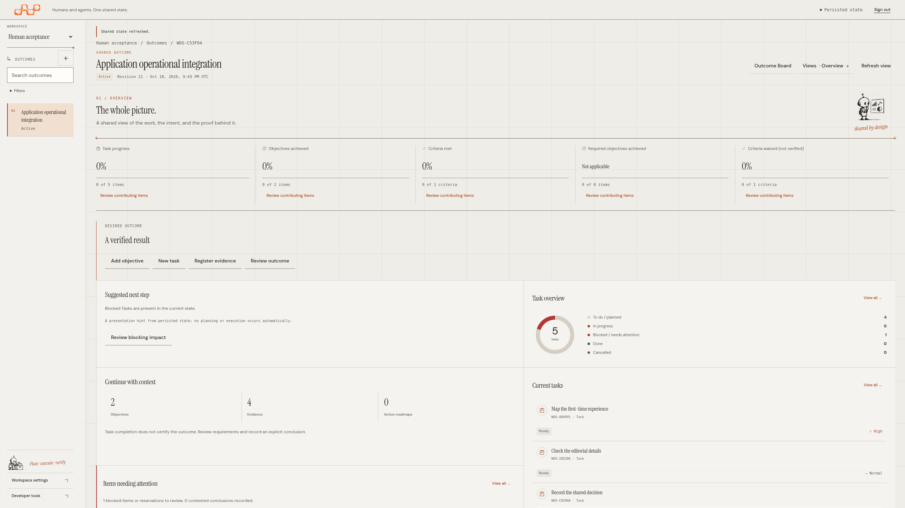
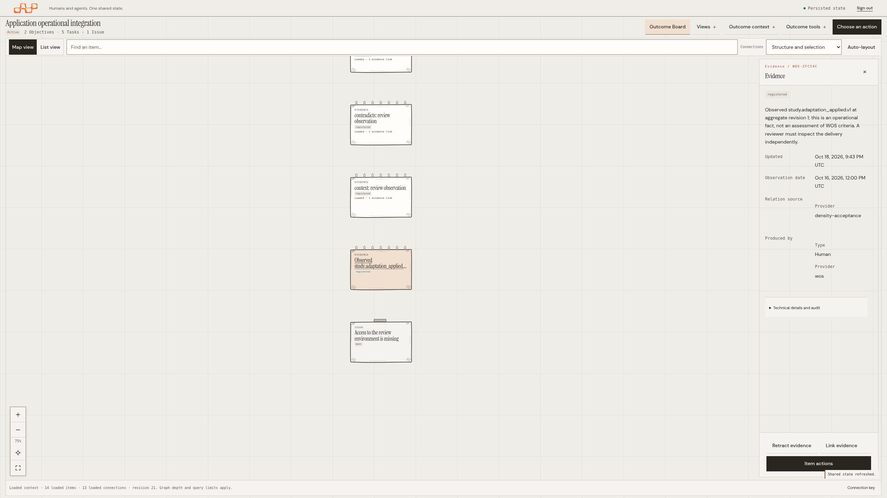
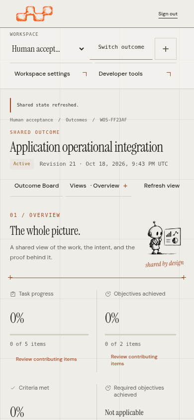
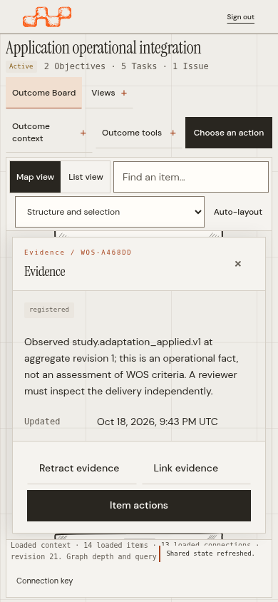

# Operational density screenshots

The [newer Board communication gallery](../board-communication/README.md) records
current feedback, action menus and relationship inspection. The captures below
retain their original density-only source qualification.

These 27 captures show the running interface at source
[`9d41b3a`](https://github.com/A1b3rt0M3rcad0/wos/tree/9d41b3aace7378ba7ed34948fb36db7f32464e47).
They document stable operational sizes and compact mobile controls, replacing
the earlier monitor-width enlargement. [Sizing decisions and Woobe reference](../operational-density.md).





| Compact navigation | Compact inspection |
| --- | --- |
|  |  |

## Verification

- 44 unit checks and all 106 browser journeys pass in one clean full run, with
  no failures, retries, skips or flaky results.
- Native web tests and vet pass. All 16 release and compatibility checks pass;
  the correction is queued for the normal patch-release workflow.
- Desktop/mobile form and detail scrolling, search, focus, permission/recovery
  flows, original paper cards and camera behavior remain covered.
- Six density scenarios include CSS 2048 × 1152 at DPR 1.25, producing a physical
  2560 × 1440 PNG. Separate native Chrome 125%/150% page-zoom journeys retain
  the full 1366 × 768 framebuffer. Neither is inferred from image dimensions.

The [manifest](screenshots.json) identifies source, browser, binary, source/test
and screenshot hashes, measured geometry and served-asset checks. Capture data
is illustrative, not customer work. Browser verification uses local Chromium;
representative-user acceptance and other browser engines are outside this run.

## All captures

| State | CSS viewport | DPR |
| --- | --- | --- |
| [board-1280x720-inspector](screenshots/board-1280x720-inspector.png) | 1280 × 720 | 1 |
| [board-1280x720-map](screenshots/board-1280x720-map.png) | 1280 × 720 | 1 |
| [board-2048x1152-dpr1.25-inspector](screenshots/board-2048x1152-dpr1.25-inspector.png) | 2048 × 1152 | 1.25 |
| [board-2560x1440-inspector](screenshots/board-2560x1440-inspector.png) | 2560 × 1440 | 1 |
| [board-2560x1440-map](screenshots/board-2560x1440-map.png) | 2560 × 1440 | 1 |
| [board-320x740-inspector](screenshots/board-320x740-inspector.png) | 320 × 740 | 1 |
| [board-3840x2160-inspector](screenshots/board-3840x2160-inspector.png) | 3840 × 2160 | 1 |
| [board-3840x2160-map](screenshots/board-3840x2160-map.png) | 3840 × 2160 | 1 |
| [board-390x844-inspector](screenshots/board-390x844-inspector.png) | 390 × 844 | 1 |
| [board-390x844-map](screenshots/board-390x844-map.png) | 390 × 844 | 1 |
| [empty-workspace-1280x720](screenshots/empty-workspace-1280x720.png) | 1280 × 720 | 1 |
| [empty-workspace-2560x1440](screenshots/empty-workspace-2560x1440.png) | 2560 × 1440 | 1 |
| [empty-workspace-320x740](screenshots/empty-workspace-320x740.png) | 320 × 740 | 1 |
| [login-320x740](screenshots/login-320x740.png) | 320 × 740 | 1 |
| [login-390x844](screenshots/login-390x844.png) | 390 × 844 | 1 |
| [overview-1280x720](screenshots/overview-1280x720.png) | 1280 × 720 | 1 |
| [overview-2048x1152-dpr1.25](screenshots/overview-2048x1152-dpr1.25.png) | 2048 × 1152 | 1.25 |
| [overview-2560x1440](screenshots/overview-2560x1440.png) | 2560 × 1440 | 1 |
| [overview-320x740](screenshots/overview-320x740.png) | 320 × 740 | 1 |
| [overview-3840x2160](screenshots/overview-3840x2160.png) | 3840 × 2160 | 1 |
| [overview-390x844](screenshots/overview-390x844.png) | 390 × 844 | 1 |
| [task-form-2560x1440](screenshots/task-form-2560x1440.png) | 2560 × 1440 | 1 |
| [task-form-390x844](screenshots/task-form-390x844.png) | 390 × 844 | 1 |
| [canvas-native-zoom-125-inspector](screenshots/canvas-native-zoom-125-inspector.png) | 1093 × 614 | 1.25 |
| [canvas-native-zoom-125](screenshots/canvas-native-zoom-125.png) | 1093 × 614 | 1.25 |
| [canvas-native-zoom-150-inspector](screenshots/canvas-native-zoom-150-inspector.png) | 911 × 512 | 1.5 |
| [canvas-native-zoom-150](screenshots/canvas-native-zoom-150.png) | 911 × 512 | 1.5 |

## Reproduce

Build the embedded service from the selected checkout before running the tests:

```sh
go build -trimpath -buildvcs=false \
  -ldflags "-X github.com/A1b3rt0M3rcad0/wos/packages/wos-api/internal/server.Commit=$(git rev-parse HEAD)" \
  -o bin/wos ./packages/wos-api/cmd/wos
cd tests/web
npm ci
WOS_CAPTURE_DENSITY=/tmp/wos-density-complete-rich \
WOS_CAPTURE_CANVAS_FIRST=/tmp/wos-density-complete-layout \
PLAYWRIGHT_JSON_OUTPUT_NAME=/tmp/wos-density-complete-results.json \
  npm test -- --workers=2 --reporter=line,json
```

Use `WOS_TEST_CHROMIUM_PATH` when selecting a locally installed full Chromium.
Native zoom runs use isolated browser profiles and Chrome's Settings API.
