# Operational workspace: current interface

The Outcome Board keeps planning, work and verification in one contextual
workspace. Quick creation, persistent participant updates and shared inspection
extend the existing editorial identity: original paper assets, restrained type,
matte surfaces and explicit operational state.

Read the [operator guide](../../../ux/operational-workspace/README.md) for the
workflow and the [qualification report](../../../ux/operational-workspace/qualification.md)
for executed checks and remaining acceptance. These captures describe the source
branch, not the currently published npm package.

## Main pages

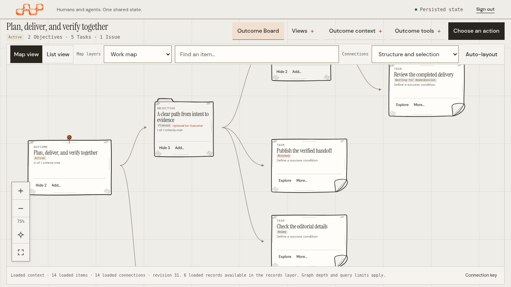

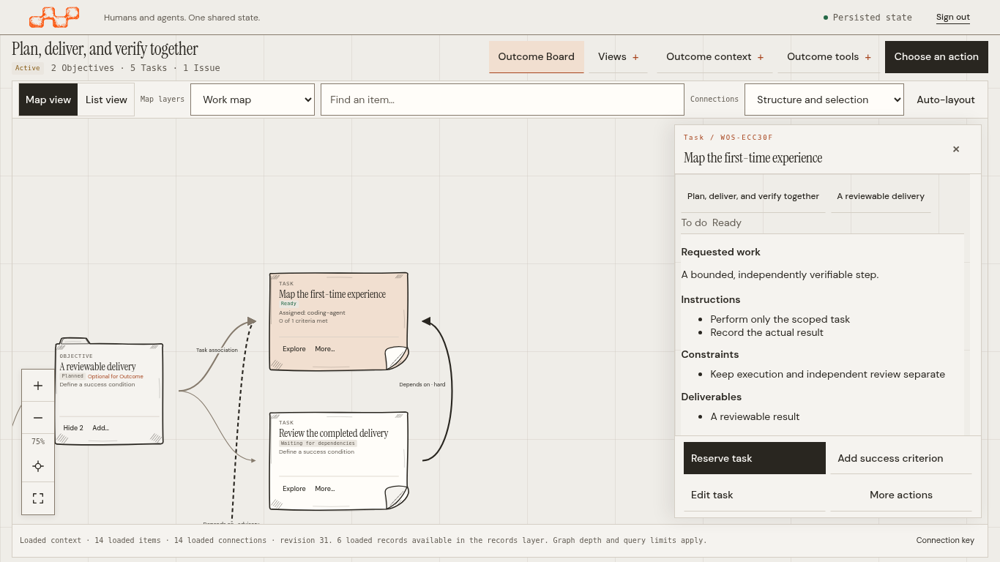

| Desktop login | Mobile login |
| --- | --- |
| [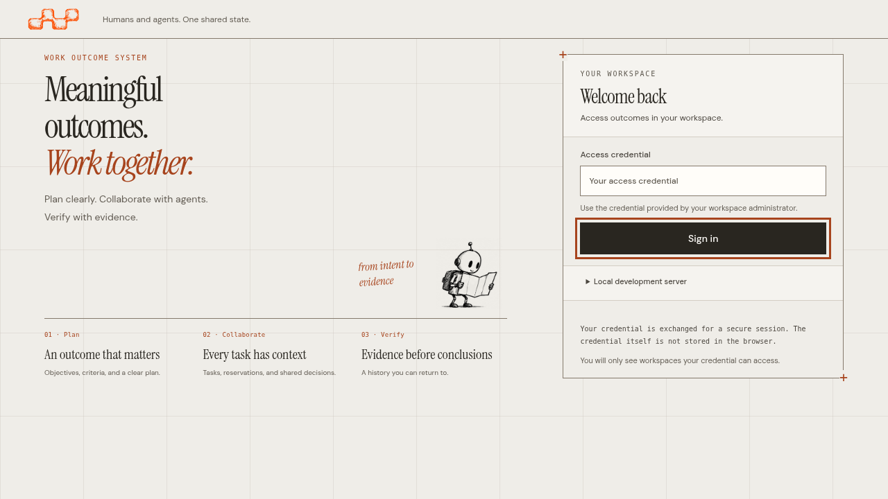](screenshots/d458d4782d18/login-1280x720.png) | [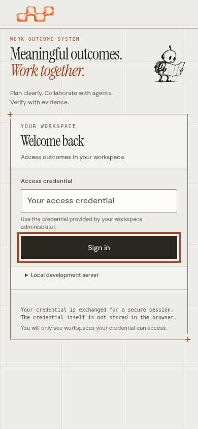](screenshots/d458d4782d18/login-390x844.png) |

| Default mobile Board list | Mobile Task inspection |
| --- | --- |
| [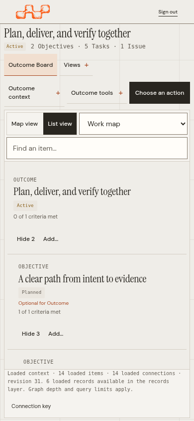](screenshots/d458d4782d18/board-default-list-390x844.png) | [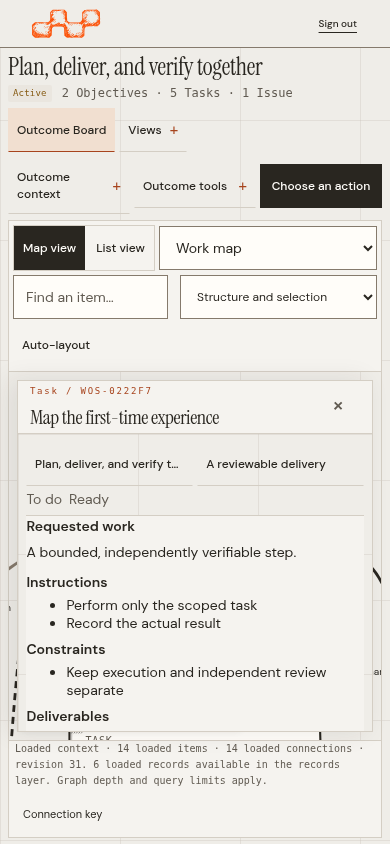](screenshots/d458d4782d18/task-390x844.png) |

The narrow Board starts in List view. These captures also exercise the explicit
[Map view](screenshots/d458d4782d18/board-390x844.png); this does not change its default.

## Plan and review in context

These are unsaved drafts and read-only previews. Opening them creates no Task,
Issue, Blocker or conclusion. Counts and names come from actual authorized reads;
limited lists disclose their coverage.

| Contextual actions on desktop | Contextual actions on mobile |
| --- | --- |
| 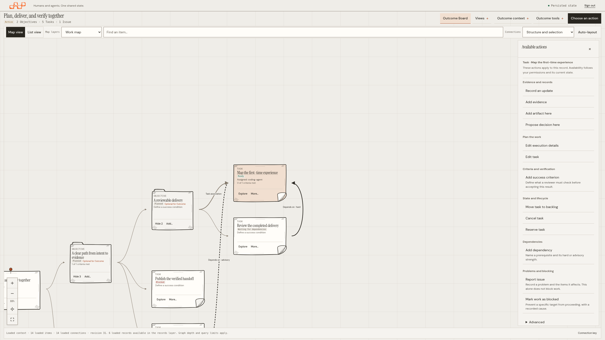 |  |

| Quick Task | Explicit batch preview |
| --- | --- |
| 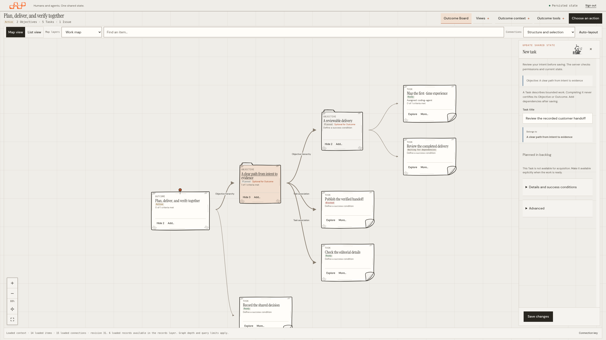 | 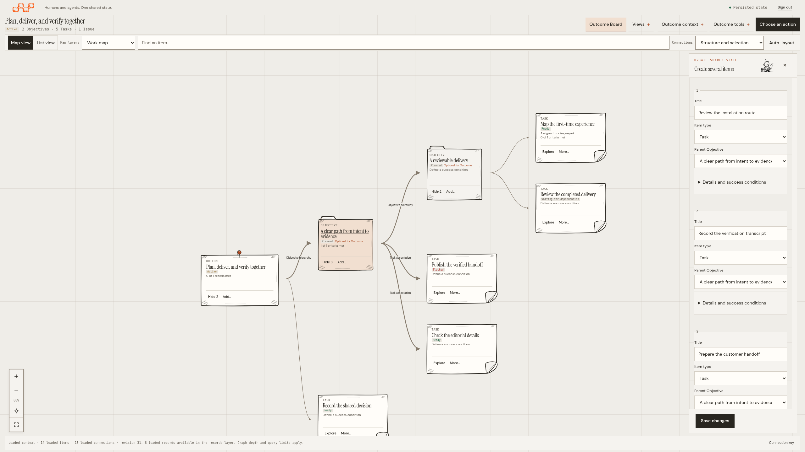 |

| Conclusion impact | Move impact | Blocking impact |
| --- | --- | --- |
|  | 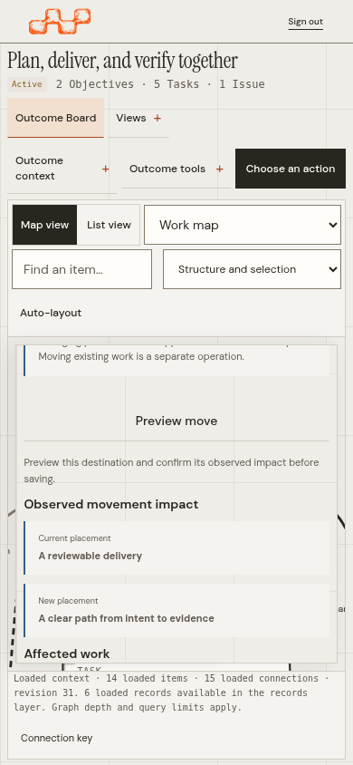 | 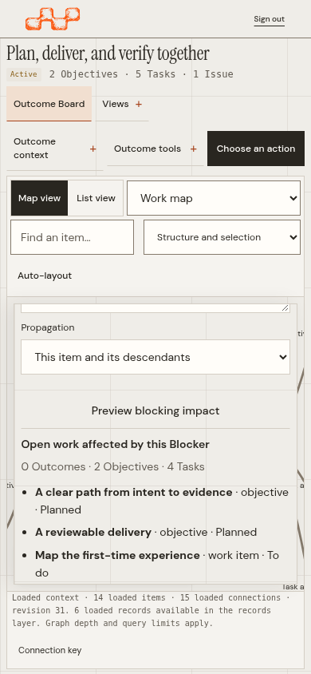 |

## Proof and related records

Evidence remains distinct from assessment and acceptance. A documentary update
retains its actual author and source; it does not assert that WOS performed the
external work. Issues and their explicit blocking impacts remain separate.

| Success condition | Evidence | Issue | Blocker |
| --- | --- | --- | --- |
| 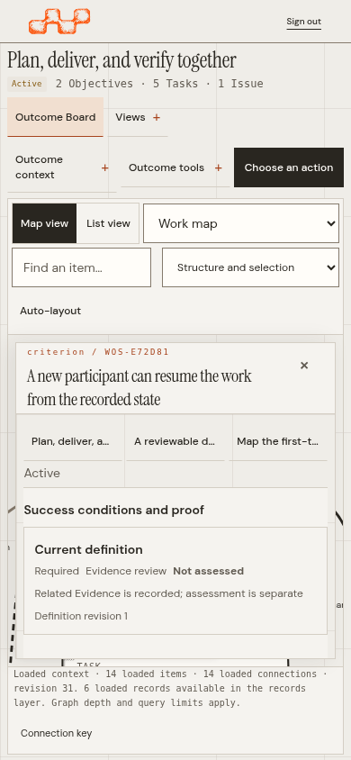 | 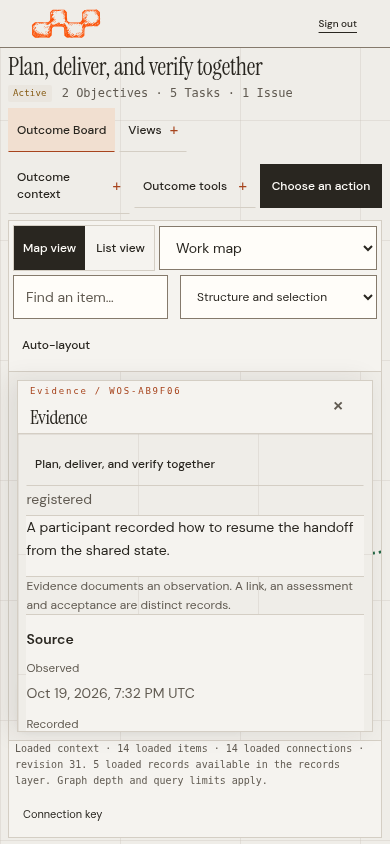 | 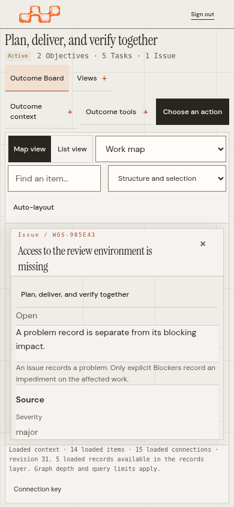 | 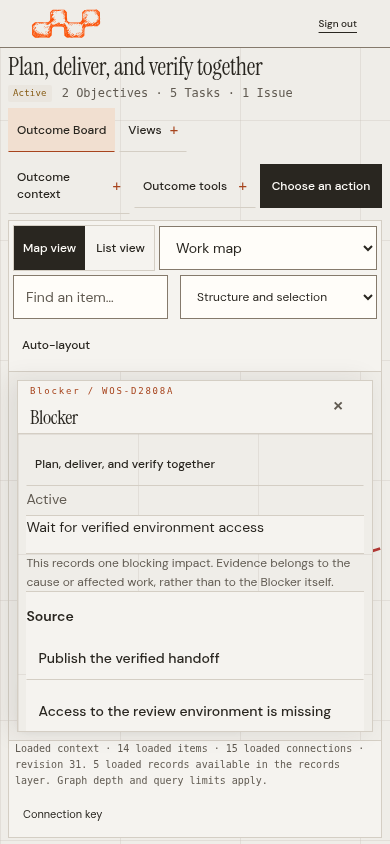 |

## Specialist views

| Overview | Plan | Work |
| --- | --- | --- |
| 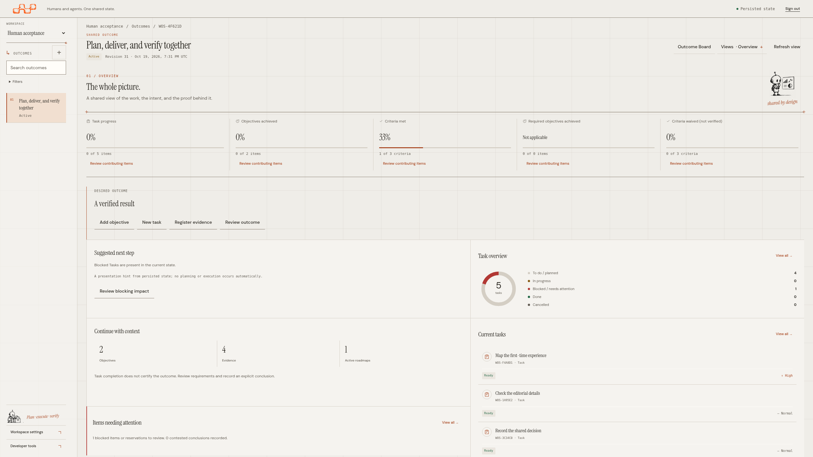 | 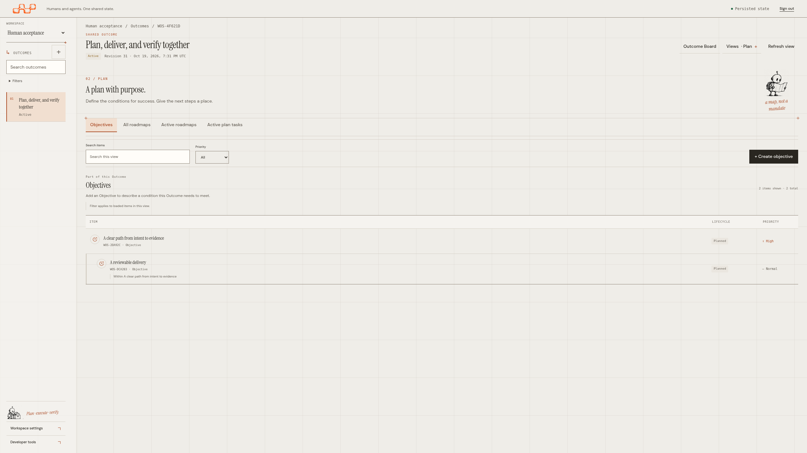 | 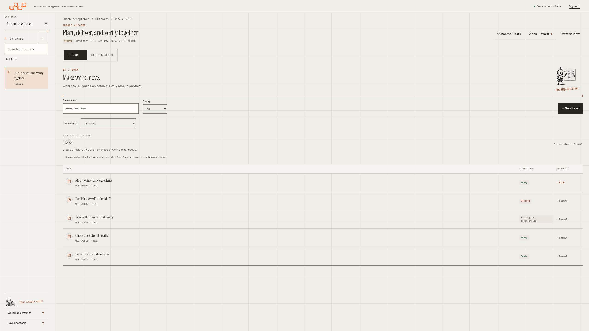 |

| Evidence | Issues | Activity |
| --- | --- | --- |
| 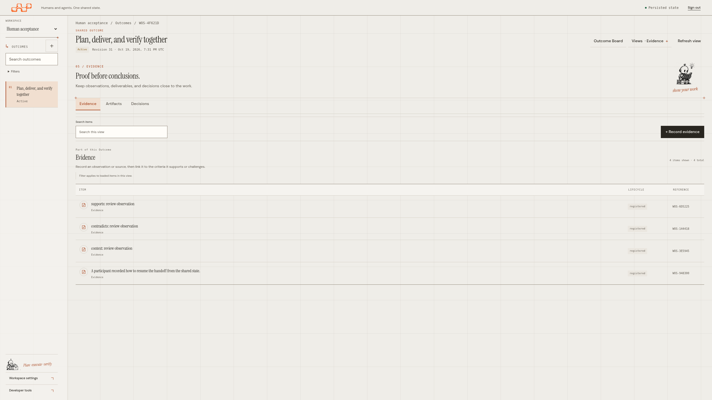 | 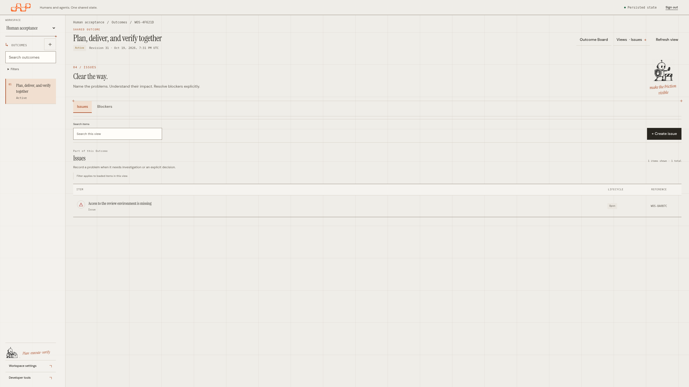 | 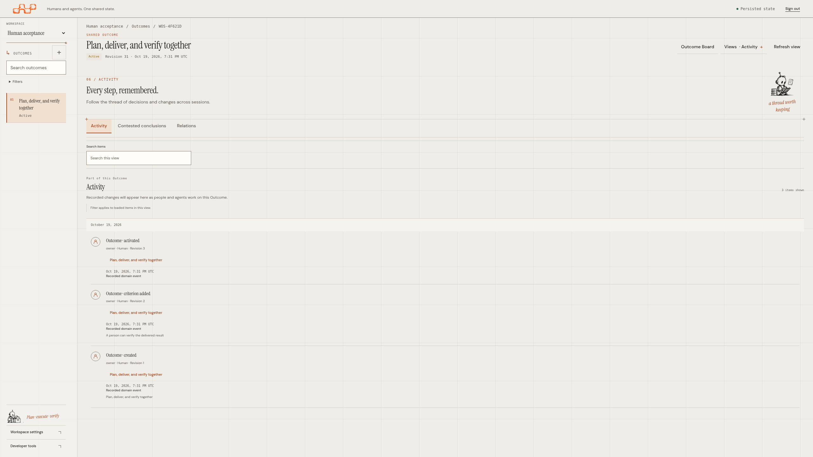 |

## Capture identity and limits

The [manifest](manifest.json) indexes **75 images and 75 individual receipts**
from 11 passing capture jobs. Capture source is `d458d4782d1813b75df4264605606837c9aff73d`;
all 40 served assets match the complete 164-journey functional run at
`36d7d2ef7b3e663500a69008f8df335aa43981a8`. The only later change is in the
opt-in capture helper. Representative visual review covers eleven final images;
its exact scope is recorded in the qualification report.
Each receipt records the committed source, binary digest, all served JavaScript,
CSS and HTML hashes, fixture sources, actual Chromium build, capture time, CSS
viewport, device scale, image dimensions, geometry and image digest. The capture
harness refuses stale embedded assets and overwriting earlier evidence.

Coverage includes 1280 × 720, 1366 × 768, 1920 × 1080, 2560 × 1440, 3840 × 2160,
320 × 740, 390 × 844 and 430 × 932. Separate native Chromium captures use 125%,
150% and 200% browser zoom with a 1366 × 768 framebuffer; viewport dimensions and
device scale are recorded independently. Browser zoom is separate from Board
camera zoom. Screenshots use the visible viewport without content masking or
image resizing. Historical galleries remain unchanged.

Headless Chromium captures do not prove an actual mobile software keyboard,
other browser engines, a five-participant comprehension study or a production
performance guarantee. See the qualification report for those pending checks.

## Reproduce

Build the repository's server with its Version, Commit and BuiltAt metadata,
using the toolchain documented in [Contributing](../../../../CONTRIBUTING.md).
Keep the qualified commit checked out, with production code clean. From
`tests/web`, using the installed Chromium or Playwright browser:

```sh
WOS_CAPTURE_OPERATIONAL_WORKSPACE="$PWD/../../docs/design/editorial/operational-workspace/screenshots" \
WOS_CAPTURE_SOURCE_COMMIT="$(git rev-parse HEAD)" \
  npx playwright test operational-gallery.spec.mjs --workers=1
```

The normal browser suite excludes opt-in artifact jobs. Use a new source-bound
directory rather than replacing historical captures.
