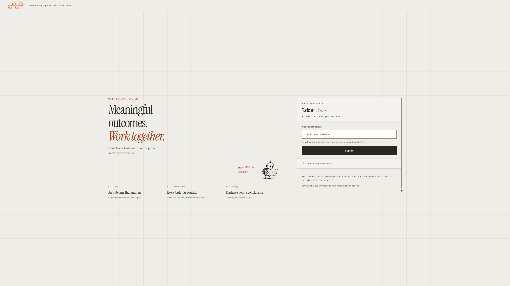
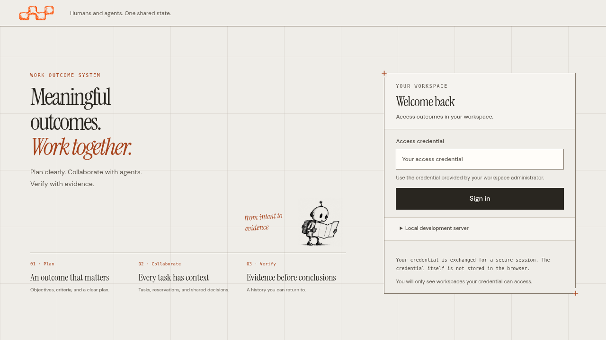
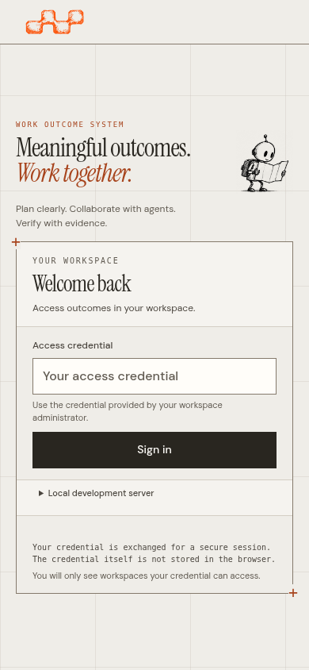

# Login: use the available viewport

The entry composition now fills the space below the actual header and centers
within it. Fonts, columns, colors, illustrations and control sizes are preserved.
Short windows and expanded local access retain normal document scrolling; content
is never centered above the reachable start of the page.

| HD | Mobile |
| --- | --- |
|  |  |

## Checks and provenance

Source: `4d86fa1c170b4c77613c35f6af4f00685aefd5d7`. The
[manifest](manifest.json) indexes twelve screenshots and their receipts. Each
receipt identifies the exact binary/source, browser, viewport/DPR, measured
composition and control bounds, image hash and all forty actual served script,
stylesheet and HTML hashes. Captures use the visible viewport without resizing
or content masking.

The new regression checks the composition's center against the usable viewport
below the measured header, rather than checking only that the form is visible.
It also checks horizontal bounds, focus and pointer access to the submit button,
and expanded local access on desktop and mobile.

| CSS viewport | Device scale |
| --- | --- |
| 1280 × 720, 1366 × 768, 1920 × 1080 | 1 |
| 2560 × 1440, 3840 × 2160 | 1 |
| 2048 × 1152 | 1.25, emulated 2560 × 1440 framebuffer |
| 320 × 740, 390 × 844, 430 × 932 | 1 |
| 844 × 390 landscape | 1 |
| Expanded local access: 1280 × 720 and 390 × 667 | 1 |

Device scale emulation is distinct from native browser zoom. Existing native
125%/150%/200% checks and the selected workspace regressions are reported in the
[login follow-up receipt](../../../../ux/operational-workspace/login-viewport-qualification.json).
No actual mobile software keyboard or independent participant study is claimed.

These images supersede the earlier login images. The preceding
[75-image workspace snapshot](../README.md) retains its original source and
qualification; its other pages were not redesigned by this login correction.
