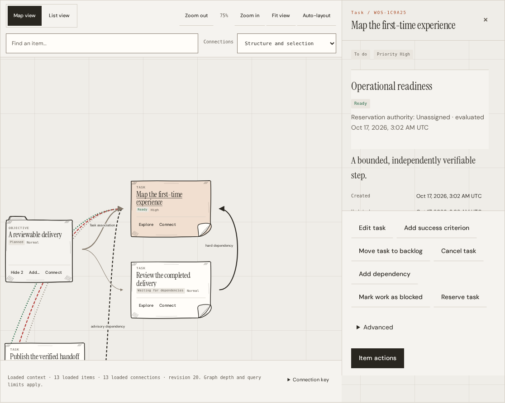
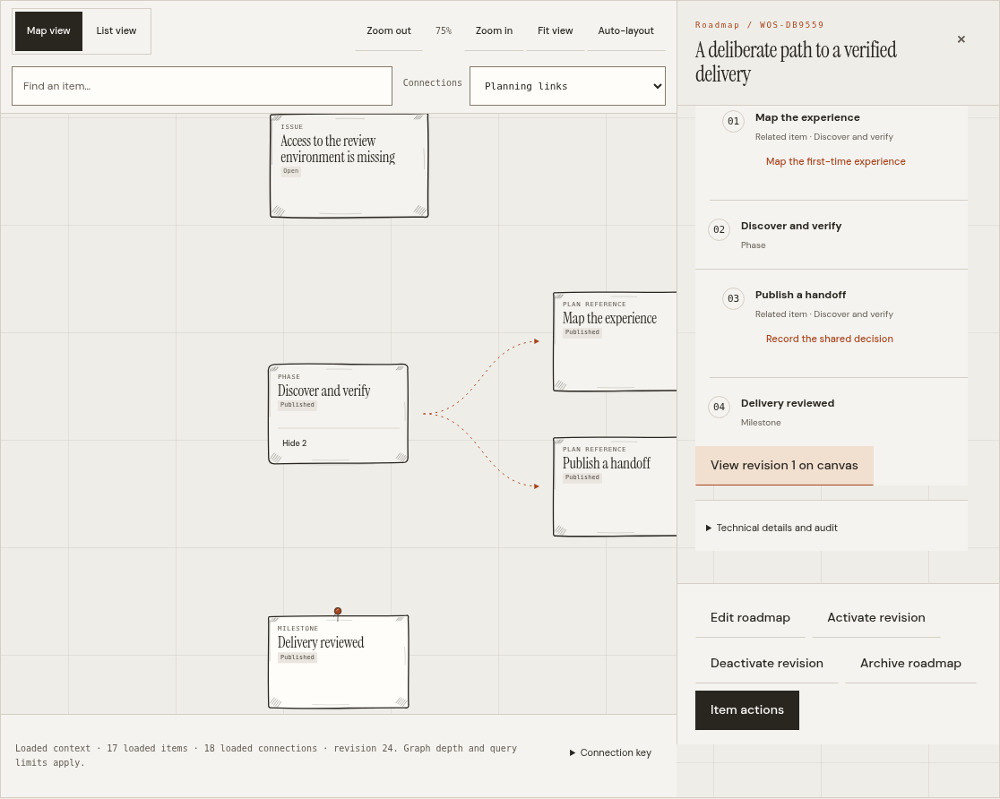

# Outcome Board

The Outcome Board brings the selected Outcome, its Objectives, Tasks and related records into one working view. It is the default working environment for an Outcome and uses the full workspace width without a left sidebar. Selecting a note opens the existing detail and action surfaces within that environment. The six purpose-based areas remain available through **Views** for summaries, complete collections and focused work. Choose **Views → Overview** to restore the sidebar and switch Outcomes or Workspaces. The board is a presentation of persisted WOS state; arranging a note does not change that state.

The map, data and action contracts below originated on `feat/visual-operational-canvas`. The [viewport-workspace follow-up](canvas-first/README.md) records the full-width shell, compact navigation and contextual-inspector changes on `feat/canvas-first-workspace`, including their separate verification status. The current public name is Outcome Board; `canvas` route values, DOM IDs and module paths remain compatible. Earlier automated checks and the [integrated gallery](#screenshots) are recorded in [verification](validation.md); those results qualify their recorded source, not this follow-up. The [editorial guide](../editorial/README.md) documents the shared visual system. The [complete workspace follow-up](workspace/README.md) covers login, every specialist area, documentary details, forms, administration and recovery on its earlier desktop/mobile baseline.

## Read the map

The Outcome anchors the composition. Objectives organize intermediate conditions; a Task belongs to its recorded Objective or directly to the Outcome. An unloaded parent is a boundary to explore, not permission to invent a different parent. Disconnected records can appear through continuity pages and authorized search even when the initial graph traversal cannot reach them.

| Visible relationship              | Source and meaning                                                                                                                |
| --------------------------------- | --------------------------------------------------------------------------------------------------------------------------------- |
| Objective hierarchy               | The Objective's recorded parent, independent of dependencies                                                                      |
| Task ownership                    | The Task's recorded Objective, independent of execution authority                                                                 |
| Hard dependency                   | An explicit `depends_on` Relation with `hard` strength; participates in the existing readiness and transition rules               |
| Advisory dependency               | An explicit `depends_on` Relation with `advisory` strength; records context without imposing a hard prerequisite                  |
| Dependency with unknown strength  | A graph edge whose compact payload omits strength; detail/context must resolve it before presenting a hard/advisory claim         |
| Blocking impact                   | A Blocker and its real target/cause; an Issue alone does not establish this impact                                                |
| Evidence link                     | A recorded supports, contradicts or context stance; it does not approve a success criterion                                       |
| Roadmap hierarchy/reference/order | A selected Draft or published revision's planning relationships, displayed separately from operational ownership and dependencies |

Connection filters and selection limit visual clutter. They change which loaded connections are drawn, not the underlying records. A selected connection retains its type and, where available, its actual reference for detail and authorized actions. Removing a dependency uses its observed version and the existing command flow; see [dependency connections](dependencies.md).

The map does not infer readiness from position, note color or apparent ordering. Compact signed-work summaries can omit current signed authority. Such notes use a conservative persisted-state label until selection retrieves current Task context and attention. A legacy lease projection is not used to declare a signed execution expired. In contract modes the summary uses the persisted Task count instead of a legacy-derived attention aggregate; selected attention is not extrapolated into an Outcome-wide signed count.

## Work without leaving the context

Select a note to inspect its current record, criteria, related context and permitted actions. Contextual creation and connection controls reuse the existing forms, authorized reference search and action registry. Their availability is determined from current permissions and entity state. The data adapter and renderer do not grant permissions.

The inspector reuses the live detail, form and action DOM rather than creating a second mutation implementation. An open form preserves its inputs and prevents navigation from replacing its intent. Closing a surface restores focus to its originating control when that control remains available. In the Outcome Board, viewports at most 1400 CSS px wide or 800 CSS px high use an overlay within the workspace, preserving the map's dimensions instead of placing the inspector below it. Wider and taller viewports show it beside the map. The Outcome header, toolbar and footer remain outside its map/list stage. Its body and long detail-action footer normally have separate scroll regions; short phones use whole-surface inspection scrolling to retain a reading area. Contextual command forms retain reachable submit controls. It remains nonmodal; existing native dialogs retain their separate focus and backdrop behavior. Refresh preserves the current camera and does not force a document scroll. The earlier document-flow inspector remains part of the historical verification baseline.

Version conflicts still require comparing the current entity and explicitly choosing a fresh intent. An uncertain write retains its exact payload and idempotency key. A read refresh is distinct from submitting another write. Scope changes, lost authorization and obsolete responses cannot publish old data into a new canvas.

### Signed execution and independent review

For `signed_contracts_v2`, Task details offer copyable execution or review handoffs for an authorized external CLI host profile. The browser does not receive a signing key or acquire host authority. Review remains a separate authorized identity and decision; delivered work, declared activity, registered Evidence, criterion assessments and conclusions retain their distinct meanings. Provisioning and exact-intent recovery are described in [signed host profiles](../../signed-workspace-profiles.md).

## Optional Roadmap overlay

An Outcome can operate without a Roadmap. **Browse Roadmaps** opens the existing Plan area; authorized canvas search also finds Roadmaps without loading every plan or its history. Selecting a Roadmap can overlay either its current open Draft or a particular published revision. Replacing that overlay removes only the previous planning presentation.

- A **Draft** is editable planning material. The overlay uses the already-loaded Draft at the same Outcome revision.
- **Publish revision** freezes a historical plan. Viewing that revision does not activate it.
- **Activate revision** explicitly selects an applicable published plan through the existing command and permission checks. A published revision can be viewed without being active.

Phases, milestones and plan references are presentation nodes with a real Roadmap reference, not fabricated operational entities. A plan reference points to its Objective or Task without changing that entity's parent. Only explicit `after_links` produce planning sequence connections; a node's display position does not create a dependency. Removing or moving a plan reference does not cancel, block, complete or reparent work. The chosen overlay survives a refresh by re-reading that specific source at the new Outcome revision. A closed Draft clears its overlay. **Hide plan** removes planning presentation while preserving operational records and connections.

## Navigate at any size

The Outcome Board uses the viewport space remaining below the compact global and Outcome controls. An **Outcome Board** control and **Views** disclosure replace the seven-item navigation row. The left sidebar is hidden only in this view; **Views → Overview** restores it for Outcome/Workspace switching, creation, settings and tools. Plan, Work, Issues, Evidence and Activity also retain the sidebar. **Outcome context** retains the summary and planning information without placing it permanently above the map. The global **Outcome tools** and **Choose an action** controls appear only in Outcome Board. Other views retain local collection/entity actions and a quiet **Refresh view** control; Overview's local **Review outcome** opens the existing Outcome detail and criteria. This changes presentation, not the available areas, entity permissions or command semantics. See the [shell decisions and acceptance matrix](canvas-first/README.md) for the viewport contract and current validation status.

The sidebar's single **Search outcomes** field queries authorized server results as the user types. **Filters** applies lifecycle and archive selection, and **More outcomes** remains tied to the current query. A query change resets its pagination; late results cannot replace a newer search. The compact original robot/footer caption remains a small editorial accent. See [Outcome discovery](../../workspace-ux.md#find-another-outcome) for operation.

Floating map controls provide zoom in/out, **Center view** without changing scale, and **Fit view** for the complete loaded map in the available region beside inspection. **Auto-layout** remains an explicit toolbar action that resets local placement. At distant zoom, miniature secondary map controls are hidden; selecting the whole card opens full-size actions, and List view retains direct controls. Dragging empty map space pans; dragging a note changes its local visual position. These gestures send no domain mutation. Camera, collapsed groups and local note positions are retained while updating the same mounted scope; they are not durable coordination records.

**List view** presents the same loaded model without requiring panning or precise connection targets. It is the default on compact screens. The separate Work area retains its Task list and **Task Board**, including server-backed All Tasks search; the Outcome Board list does not claim to contain every Task in the Outcome.

Keyboard controls are scoped to the focused element:

| Focus               | Controls                                                                                                                                      |
| ------------------- | --------------------------------------------------------------------------------------------------------------------------------------------- |
| Note                | Enter/Space selects; Up/Down moves through visible notes; Left moves to the parent; Right moves to a visible child; Home moves to the Outcome |
| Map background      | Arrow keys pan; `+`/`-` zoom; `0` fits the loaded map                                                                                         |
| Connection          | Enter/Space opens its available context                                                                                                       |
| Search              | Up/Down chooses a result, Enter selects, Escape closes suggestions; Load more retrieves further authorized results                            |
| Contextual controls | Native buttons, fields and menus retain their keyboard behavior; Escape closes an inspector surface after nested controls have handled it     |

Search combines loaded matches with the authorized server candidate query. Selecting a result can load its neighborhood; it does not require that the initial map already contain it. Expand/collapse controls expose groups progressively. Load more retrieves another bounded source page, and the visible status reports loaded items, connections and collapsed content.

The existing warm paper, fixed editorial grid, Instrument Serif, DM Sans, monospace metadata, orange chain and monochrome robots remain authoritative. The existing viewport scale above 1440 CSS px is separate from the map's internal camera zoom. A map transform is local to its world, not a global page-scale replacement. Mobile reflow and reduced-motion behavior remain part of acceptance.

## Data architecture

The browser remains native ES modules served by the Go application, without a framework or production package migration.

| Module                   | Responsibility                                                                                                                |
| ------------------------ | ----------------------------------------------------------------------------------------------------------------------------- |
| `app.js`                 | Existing authentication, scope, route and refresh lifecycle; current permissions; detail/form commands; exact-intent recovery |
| `canvas-data.js`         | Scoped reads, revision validation, pagination and immutable presentation models                                               |
| `workspace-canvas.js`    | HTML note/list rendering, SVG connections, local layout/camera, keyboard and selection callbacks                              |
| `workspace-inspector.js` | Mounting the existing detail/form/action content inline and restoring its original surfaces outside canvas mode               |
| `canvas-context.js`      | Bounded readable focal instructions, typed relationships, attention and explicit omission disclosure                          |
| `canvas.css`             | Existing tokens, ratio-preserving note surfaces, inspector and responsive presentation                                        |

The adapter receives the existing authenticated request function. It has no independent credential store. A model carries stable scoped entity keys, an exact decimal Outcome revision, typed edges, source metadata, loaded counts, omission counts and cursors. Aggregate versions remain available for contextual actions, but callers still load current entity detail before constructing a command.

Let `O` be the configured API prefix followed by `/namespaces/{namespace_id}/outcomes/{outcome_id}`. The adapter uses existing read endpoints:

| Read                                             | Use and boundary                                                                                                                                                  |
| ------------------------------------------------ | ----------------------------------------------------------------------------------------------------------------------------------------------------------------- |
| `GET O/continuity`                               | Transactionally consistent starting snapshot, bounded sections, real counts/omissions and active plan headers                                                     |
| `GET O/graph`                                    | Initial depth-3 hierarchy/ownership and Blocker-impact traversal; depth-1 neighborhood expansion; edge-based cursor pages, at most 100 entries per requested page |
| `GET O/continuity/{section}`                     | Further bounded metadata pages, including records not reached by the structural graph                                                                             |
| `GET O/references`                               | Authorized typed candidate search, 25 results per request                                                                                                         |
| `GET O/work-items/{id}/context` and `/attention` | Current focal Task context and signed-aware attention when selecting a Task                                                                                       |
| `GET O/roadmaps/{id}/revisions/{number}`         | A selected immutable plan revision; its current response envelope must match the model revision                                                                   |

Selecting a supported graph entity also retrieves one cached depth-1 neighborhood, so a Blocker or Issue beyond the initial depth can be explored without an initial fan-out. Roadmaps use their separate plan source rather than an unsupported graph-root query. Entity details and their existing criterion/history reads remain selection-driven. **Load task history** explicitly retrieves 25 durable activity records at a time, with its frozen historical revision boundary; no activity is loaded for every note. Initial canvas loading does not hydrate the full Outcome state, all Roadmaps, proof bodies or complete execution history. Declared activity and domain timeline remain separate paginated records.

### Consistency and partial results

Every merged response must match the selected Namespace, Outcome and exact Outcome revision. Decimal revision values are compared without rounding them through an unsafe JavaScript number. A changed revision rejects the merge atomically and requires a fresh snapshot; cursors are not silently rebased. All canvas reads bypass browser response caching so a plan's immutable content cannot supply a stale current-revision envelope.

The adapter serializes incremental work, issues one page request per Load more gesture and rotates between graph and continuity sources. Scope/refresh epochs and disposal suppress late successes and failures. A new snapshot does not wait for obsolete queued work. Root navigation and detail generations apply the same protection to selection and inspector content.

The loaded model is always scope- and depth-limited. `partial` records known omissions, pending cursors and unresolved context; `hasMore` indicates available pages. A graph page without a next cursor completes only that traversal's depth/filter, not the entire Outcome. Initial expansion does not fetch every disconnected record. Request/page sizes are bounded; the existing server graph traversal still performs reachability work, so these limits are not a constant-cost claim for arbitrary Outcomes.

## Supplied paper assets

The owner supplied `WOS_Postits_Canvas_Collection.zip`. The [original UI brief](source/ui-ux-brief.pt-BR.txt) is archived unchanged as scope provenance; it is separate from product documentation and executable instructions. All 160 SVGs are copied unchanged into `assets/postits/svg/`; the raster counterparts remain outside the application bundle. The [asset guide and hash manifest](postits/README.md) record the archive, original file hashes, inspected vector format, safe areas and source documentation. Preserved Portuguese source documents are provenance, not application copy or additional instructions.

Every card in Map view uses an original post-it as its visible surface. Objectives use square tabbed paper; Tasks use wide curled paper; Issues use taped paper. Outcomes, Blockers, Evidence, Artifacts, Decisions and planning cards also use distinct supplied formats, documented in the [asset mapping](postits/README.md#deliberate-use-in-the-workspace).

The original SVG is a decorative image beneath live HTML titles, states and actions inside its safe area. Source proportions, folds, hatching, tabs and transparency are preserved. Selection uses the matching original selected paper and an underlined title; there is no extra rectangular frame around the silhouette. Native keyboard focus remains visible on the controls. Paper shape and color never replace explicit lifecycle, priority, blockage or review labels. Toolbars, the contextual panel, forms and the accessible List alternative retain their editorial surfaces. Compact screens start in List view and can explicitly switch to Map.

The post-its complement the [existing art direction](../../../.agents/skills/wos-art-style/SKILL.md); the original logo and robots remain separate and unchanged. No new artwork, recoloring or embedded text is needed for the canvas.

## Screenshots

The captures below record the earlier `feat/visual-operational-canvas` baseline. They use illustrative records created through real commands on an isolated SQLite instance. Desktop captures use 1440 × 1000 CSS px, the large-screen capture uses 2560 × 1440, and mobile uses 390 × 844. Board images crop the application's actual canvas shell; artwork and UI have not been composited or edited. The [current Outcome Board gallery](canvas-first/README.md#screenshots) contains 35 separate source-pinned captures at `0d84588`, including compact login, short-phone inspection and four specialist-sidebar views; current qualification remains separate from this older gallery.

| View                                          | Capture                                                                                                                                |
| --------------------------------------------- | -------------------------------------------------------------------------------------------------------------------------------------- |
| Outcome workspace                             | [Full workspace](screenshots/01-canvas-workspace.png) · [Board and contextual Task actions](screenshots/01-canvas-workspace-board.png) |
| Typed operational and documentary connections | [Workspace](screenshots/02-canvas-relationships.png) · [Board](screenshots/02-canvas-relationships-board.png)                          |
| Large, explicitly partial Outcome             | [Incremental map and off-page search](screenshots/03-canvas-large-outcome.png)                                                         |
| Compact list and contextual operation         | [Mobile workspace](screenshots/04-canvas-mobile.png)                                                                                   |
| Original post-it cards on compact screens     | [Mobile Map view](screenshots/04-canvas-mobile-map.png)                                                                                |
| Existing proportional viewport scale          | [2K workspace](screenshots/05-canvas-2k.png)                                                                                           |
| Optional published planning                   | [Roadmap workspace](screenshots/06-canvas-roadmap.png) · [Planning board](screenshots/06-canvas-roadmap-board.png)                     |

## Acceptance boundary

Real-server Canvas journeys and inherited workspace checks passed on their recorded `feat/visual-operational-canvas` baseline for contextual operations, typed dependencies, optional planning, permission/concurrency/recovery paths, signed handoffs and responsive presentation. The [verification record](validation.md) gives exact test scope, reproducible commands and remaining manual limits. [Screenshots](#screenshots) come from that integrated application with illustrative records and identified CSS viewports. The [Canvas-first qualification](canvas-first/README.md#verification-and-capture-provenance) is tracked separately; earlier results alone do not qualify its viewport shell or overlay inspector.

The current 15 entry/layout and four discovery journeys pass at `0d84588`, including compact login, stable inspection, persistent camera controls, Board-only global menus and live sidebar search. The default desktop graph occupies 70.11–73.76% of viewport height. All 44 unit checks and 99 browser journeys pass in one clean full run with no failures or skips. Exact source, served-asset checks and capture provenance are recorded in the [follow-up qualification](canvas-first/README.md#verification-and-capture-provenance). Earlier qualifications remain pinned separately.

Automated checks and screenshots do not establish representative-user usability, screen-reader acceptance or WCAG certification. Existing historical evidence remains in the [workspace acceptance record](../../ux/final-acceptance.md) and [editorial validation](../editorial/validation.md); it is not evidence for this new canvas.
