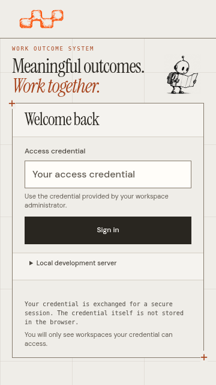

# Outcome Board workspace

The newer [operational density correction](../../editorial/operational-density.md)
removes monitor-width enlargement and compacts small-screen controls. Its
[source-bound gallery](../../editorial/density/README.md) records the current
sizes. The measurements and captures below remain historical qualification of
`0d84588`; they do not describe the newer sizing rules.

The Outcome Board is the main spatial workspace for an Outcome. It uses the viewport's remaining working region without a left sidebar. The warm editorial paper, fixed grid, original robots, post-it artwork, type and operational palette stay intact.

Implementation source: `0d84588da082f9d2b3539d00e48527b31c8d7487`, on `feat/canvas-first-workspace`, based on `master` at `cba58d6`. [PR #115](https://github.com/A1b3rt0M3rcad0/wos/pull/115) includes these presentation changes and synchronized [1.1.0 release preparation](../../../releases/1.1.0.md). The owner has authorized integration after checks. Preparation, integration and publication remain distinct; the PR and release workflows expose their current status. The closed Tenant/scaling PR is outside this work.

## Review of the proposed plan

The owner's diagnosis separates available height from horizontal responsiveness. A fixed minimum map height cannot guarantee that the graph and its controls fit below a global header, Outcome controls, navigation and summary. Increasing that minimum or introducing a second renderer would retain the cause.

The implementation uses a viewport-based flex shell, a compact Outcome header and progressive disclosure of supporting information. Woobe's Network provides the structural reference, including [persistent map controls](https://github.com/A1b3rt0M3rcad0/woobe/blob/master/packages/woobe-frontend/src/features/network/components/NetworkCanvasChrome.tsx). It introduces no runtime dependency or second graph engine.

Three safeguards guide the implementation:

- Preserve specialist views, deep links, browser history and keyboard navigation when replacing the seven-item row with **Views**.
- Assign scrolling to the map/list, inspector body and long action footer deliberately. Hiding overflow to make a capture fit is not acceptance.
- Measure the actual CSS working region. The 70–80% default desktop-height target is distinct from screenshot dimensions and native browser zoom.

## Shell and navigation decisions

| Concern | Decision | Preserved behavior |
| --- | --- | --- |
| Working region | Flex sizing and `min-height: 0` use the remaining viewport; no fixed 540-unit minimum | Existing graph, search, progressive expansion and local placement |
| Outcome header | Keep name, lifecycle and navigation compact; show Outcome tools and Choose an action only on Outcome Board | Explicit activation/conclusion, permissions and preconditions |
| Navigation | Direct Outcome Board control plus Views for Overview, Plan, Work, Issues, Evidence and Activity | Existing routes, history and focused collections |
| Sidebar | Hidden only on Outcome Board; one live Outcome search, Filters and bounded More outcomes elsewhere | Workspace/Outcome switching, creation, settings and tools |
| Summary/planning | Retained inside Outcome context | Loaded counts and separate planning/operational semantics |
| Specialist actions | Quiet Refresh view; Overview has Review outcome and existing local actions | Canonical forms and current entity authority |
| Inspection | Original detail/form/action DOM lives inside the map/list stage | Pending input, current versions, exact uncertain intent and focus return |
| Task Board | Remains a specialized Task view in Work | Separate purpose and visible name |

Internal `canvas` route values, DOM IDs and module paths remain compatible. Specialist pages retain normal reading and collection scrolling; this viewport shell applies to the selected Outcome Board.

### Inspection without header movement

The toolbar and footer sit outside the new graphic stage. Opening a card therefore cannot shrink or cover the search, connection filter, view controls or Outcome header.

At **1400 CSS px wide or less**, or **800 CSS px high or less**, the inspector overlays only the stage, preserving the map's dimensions. Wider and taller screens dock it beside the map. Both presentations use the existing matte tokens, a ruled heading, compact metadata and balanced action columns. The body and long detail-action footer normally scroll independently. On phones at most 700 CSS px high, the whole inspector surface scrolls so its heading and action footer cannot consume all reading space. Contextual forms retain reachable submit controls.

Inspection stays nonmodal. The map is not made inert and there is no dialog focus trap. Escape respects nested controls first; closing returns focus to a still-mounted origin. Native dialogs keep their own backdrop and focus behavior. Renderer disposal restores the persistent inspector host before removing the map, preserving the original form nodes and listeners.

### Persistent map controls

A floating group remains inside **Map view**, separate from the toolbar:

| Control | Effect |
| --- | --- |
| + / Zoom in | Enlarge around the available map area's center |
| − / Zoom out | Reduce scale, including the overview scale needed to fit the loaded map |
| Percentage | Current internal map zoom; independent of browser/UI scale |
| Center view | Center the loaded map without changing its zoom or note positions |
| Fit view | Fit the complete loaded map into the available region, accounting for a right inspector overlay |
| Auto-layout, in the toolbar | Explicitly reset local note placement, then fit |

Controls have labelled 44 × 44 CSS px minimum targets and keyboard focus. The group becomes horizontal on mobile and in short windows. Initial entry keeps notes readable; an explicit Fit can show an overview. Selecting a card or using List view provides full-size information and actions at distant zoom.

Dragging the background pans; focused-background arrows pan, `+`/`-` zoom and `0` fits. Camera actions and local placement issue no domain commands. Closing inspection preserves the current camera.

### Compact login

The login composition adapts to available height instead of stacking a desktop-sized introduction over the form. Compact desktop windows reduce presentation spacing; mobile puts the original map robot beside a shorter heading. Short phones omit secondary introductory copy while retaining the credential label, guidance, field, Sign in, optional local access and session explanation.

The complete default credential login fits the six recorded compact viewports without document scrolling or clipped controls. Fields/buttons retain at least 44 px touch targets; mobile inputs retain readable 16 px type. Expanded local access, enlarged text and a constrained viewport can scroll naturally. No fixed-height login mask or global overflow suppression is introduced.

### Outcome discovery

The specialist sidebar's **Search outcomes** performs an authorized server query after a 250 ms pause. Enter and filter changes apply immediately. Query changes reset pagination; cancellation, query/epoch checks and deduplication prevent stale responses or old More pages from appearing under a newer query. Losing authorization clears private results.

The original organizer illustration and caption remain a compact footer accent. All six specialist areas retain navigation; Views → Overview restores Outcome/Workspace switching from the Board.

## Operational meaning stays unchanged

Cards and connections represent loaded persisted state at the selected revision. Position, paper, grouping or Roadmap order does not grant authority, create dependencies or prove readiness. Loaded dependency, Blocker and EvidenceLink counts describe loaded connections, not complete totals. An Issue is not implicitly a Blocker; related Evidence is not a verified criterion.

The existing [map contract](../README.md#read-the-map), [dependency actions](../dependencies.md), [post-it provenance](../postits/README.md) and [signed host profiles](../../../signed-workspace-profiles.md) remain authoritative. The browser reuses the canonical forms, reference searches, permissions and recovery behavior. No domain, backend, schema, protocol or artwork change is included.

## Acceptance matrix

| Environment | Check | Result |
| --- | --- | --- |
| Login: 1280 × 720, 1366 × 768, 1024 × 768 | Complete default credential composition, no document overflow, whole 44 px controls, keyboard and actual sign-in | Passed |
| Login: 390 × 844, 360 × 640, 320 × 740 | Same checks with compact presentation and original robot | Passed |
| Login: 320 × 640, expanded local access and enlarged text | Natural scroll, whole reachable controls and no horizontal overflow | Passed |
| Board: 1280 × 720, 1366 × 768 | Visible map, stable header/toolbar, overlay inspection, reachable actions, centering/zoom/fit | Passed |
| Board: 1920 × 1080, 2560 × 1440 | Proportional scale, docked inspection and the same camera/navigation checks | Passed |
| Board: 320 × 740, 390 × 844 | List/map alternatives, independent inspection/form scrolling, focus and history | Passed |
| Board: 360 × 640 | Horizontal camera controls; whole-surface detail scrolling, readable content, reachable actions and close | Passed |
| Native Chromium zoom 125% and 150% | Controls, inspection and focus return at the actual reduced CSS viewport | Passed |
| Full browser regression | Navigation, authority, races, canonical forms, uncertain intent, signed handoffs and accessibility checks | 99 passed; 0 failed; 0 skipped |

The default desktop graph meets the 70–80% height objective. These measurements exclude the toolbar/footer; opening an inspector preserves their bounds exactly. The target is not imposed on a smaller zoomed CSS viewport or an expanded panel.

| CSS viewport | Graph width | Graph top–bottom | Graph height | Share of viewport height | Inspector |
| --- | --- | --- | --- | --- | --- |
| 1280 × 720 | 1246.00 px | 163.19–668.00 px | 504.81 px | 70.11% | Overlay |
| 1366 × 768 | 1332.00 px | 163.19–716.00 px | 552.81 px | 71.98% | Overlay |
| 1920 × 1080 | 1875.34 px | 216.19–1011.34 px | 795.16 px | 73.63% | Docked beside map |
| 2560 × 1440 | 2501.12 px | 286.94–1349.12 px | 1062.19 px | 73.76% | Docked beside map |

## Verification and capture provenance

On 2026-10-18, a clean full run passed **44 unit checks and all 99 browser journeys**, with zero failures and zero skips, in **6.3m**. The embedded server identifies implementation source `0d84588da082f9d2b3539d00e48527b31c8d7487`. All 26 production JavaScript/CSS/HTML input hashes remain identical across the run and capture source. Later documentation changes do not alter those inputs; hosted checks qualify the pushed PR head separately.

The run includes all **15 entry/layout/capture journeys**, producing **35 images**, and all four Outcome-discovery journeys. It verifies initial and selected states, exact header/toolbar bounds, whole hit-tested camera targets, center preserving zoom, Fit showing the complete loaded map beside inspection, touch targets, local/enlarged-text entry, readable short-phone inspection, forms/actions, Escape/focus, history/reload and no domain writes during map exploration. Existing permission, revocation, stale-response, exact-retry and signed-handoff checks also pass.

Native web tests and vet pass. Four release-compatibility checks pass, including coordinated README/VERSION/npm/OpenAPI metadata. Actual **1.1.0 artifacts from the same source** also pass the offline installed-package verifier: matching product/client/Skill versions, artifact hashes and legal files, native Skill operations, signed execution and independent review/recovery, HTTP/MCP/UI readiness, graceful shutdown and corruption rejection. The manifest records the four artifacts and 12 verifier checks. Windows packages are cross-built and checked structurally here; native Windows execution and exact final-head release gates remain hosted requirements. No registry publication is inferred.

Each capture journey fetches seven production assets from the actual server and compares their SHA-256 hashes with source: `app.js`, `canvas.css`, `editorial.css`, `en-US.js`, `index.html`, `workspace-canvas.js` and `workspace-entry.css`. Every image records the verified served hashes; all 245 recorded image/asset comparisons match. The [manifest](screenshots.json) records all embedded asset hashes, the source-pinned server binary, test/fixture hashes, viewport geometry, capture method and image hashes.

Captures use full Chromium 154.0.8037.57 on Linux amd64 with Playwright 1.62.1 and isolated SQLite data per journey. Illustrative records are created through real public commands. Fonts and visible images finish loading before capture. Images are unannotated application viewports, without resizing, compositing or CSS zoom.

Native page zoom uses Chromium's Settings API in isolated profiles. It verifies CSS viewport, device-pixel ratio, unchanged outer size and `visualViewport.scale === 1`; CDP captures the full visible framebuffer without a CSS-sized clip. A reduced viewport or device scale factor alone is not native-zoom evidence.

| Browser page zoom | Actual CSS viewport | Device-pixel ratio | Graphic height | Captured framebuffer |
| --- | --- | --- | --- | --- |
| 125% | 1093 × 614 | 1.25 | 352.40 CSS px | 1366 × 768 px |
| 150% | 911 × 512 | 1.5 | 258.81 CSS px | 1366 × 768 px |

The [previous qualification at `8504108`](https://github.com/A1b3rt0M3rcad0/wos/blob/85041088eb779561c07890d3a14514c3ee36e1a4/docs/design/operational-canvas/canvas-first/README.md) preserves the former 26-image source and separate 91+1 browser cohorts. Earlier [sidebar-free](https://github.com/A1b3rt0M3rcad0/wos/blob/15593b763a820d97026db2354b8013424798c2e9/docs/design/operational-canvas/canvas-first/README.md), [initial shell](https://github.com/A1b3rt0M3rcad0/wos/blob/c12177ac92a2e4a1f7ed9bd45c296cd811a939f0/docs/design/operational-canvas/canvas-first/README.md), [workspace](../workspace/README.md) and [responsive-scale](../../editorial/responsive-scale.md) records qualify their own historical baselines.

## Screenshots

All 35 images come from the recorded implementation source. Historical `canvas` filenames remain valid after the visible rename. Specialist captures show their visible viewport and retain normal document scrolling.

| Environment or state | Captures |
| --- | --- |
| Compact desktop login | [1280 × 720](screenshots/login-1280x720.png) · [1366 × 768](screenshots/login-1366x768.png) · [1024 × 768](screenshots/login-1024x768.png) |
| Mobile login | [390 × 844](screenshots/login-390x844.png) · [360 × 640](screenshots/login-360x640.png) · [320 × 740](screenshots/login-320x740.png) |
| Compact HD, 1280 × 720 | [Outcome Board](screenshots/canvas-1280x720.png) · [Overlay inspector](screenshots/canvas-1280x720-inspector.png) |
| Notebook HD, long Outcome title | [1366 × 768](screenshots/canvas-1366x768.png) · [Inspector](screenshots/canvas-1366x768-inspector.png) · [Complete loaded map fitted beside inspection](screenshots/canvas-1366x768-fitted.png) |
| Full HD, 1920 × 1080 | [Outcome Board](screenshots/canvas-1920x1080.png) · [Docked inspector](screenshots/canvas-1920x1080-inspector.png) |
| QHD, 2560 × 1440 | [Outcome Board](screenshots/canvas-2560x1440.png) · [Docked inspector](screenshots/canvas-2560x1440-inspector.png) |
| Progressive controls | [Views](screenshots/canvas-views.png) · [Outcome context and planning](screenshots/canvas-outcome-context.png) |
| Desktop specialist navigation | [Overview](screenshots/canvas-1366x768-overview-sidebar.png) · [Work](screenshots/canvas-1366x768-work-sidebar.png) |
| Short mobile map, 360 × 640 | [Horizontal camera controls and fitted loaded map](screenshots/canvas-360x640-map.png) · [Scrollable inspection](screenshots/canvas-360x640-inspector.png) |
| Compact specialist navigation | [Overview, 320 × 740](screenshots/canvas-320x740-overview-sidebar.png) · [Overview, 390 × 844](screenshots/canvas-390x844-overview-sidebar.png) |
| Compact, 320 × 740 | [List](screenshots/canvas-320x740-list.png) · [Inspector](screenshots/canvas-320x740-inspector.png) · [Form](screenshots/canvas-320x740-form.png) · [Map](screenshots/canvas-320x740-map.png) |
| Mobile, 390 × 844 | [List](screenshots/canvas-390x844-list.png) · [Inspector](screenshots/canvas-390x844-inspector.png) · [Form](screenshots/canvas-390x844-form.png) · [Map](screenshots/canvas-390x844-map.png) |
| Native page zoom 125% | [Outcome Board](screenshots/canvas-native-zoom-125.png) · [Inspector](screenshots/canvas-native-zoom-125-inspector.png) |
| Native page zoom 150% | [Outcome Board](screenshots/canvas-native-zoom-150.png) · [Inspector](screenshots/canvas-native-zoom-150-inspector.png) |


<a href="screenshots/login-360x640.png"></a>

## Reproduce

Use the documented Go/Node toolchains and full Chromium. Rebuild the embedded web assets before testing:

```sh
# Repository root
go build -trimpath -buildvcs=false \
  -ldflags "-X github.com/A1b3rt0M3rcad0/wos/packages/wos-api/internal/server.Commit=$(git rev-parse HEAD)" \
  -o bin/wos ./packages/wos-api/cmd/wos
go build -trimpath -o bin/wosctl ./packages/wos-cli/cmd/wosctl
cd tests/web
npm ci
npm test -- --reporter=list
```

For the focused viewport, entry, inspection and zoom journeys with captures:

```sh
WOS_CAPTURE_CANVAS_FIRST="$PWD/../../docs/design/operational-canvas/canvas-first/screenshots" \
  npx playwright test canvas-workspace-layout.spec.mjs
```

Set `WOS_TEST_CHROMIUM_PATH` for an installed full Chromium. Native zoom requires its Settings API; headless-shell is insufficient. Regenerate the manifest when replacing captures. Other browser engines, representative-user usability, manual screen-reader acceptance and real mobile keyboard behavior remain outside this automated qualification; no WCAG certification, backend-capacity or registry-publication claim is made.
