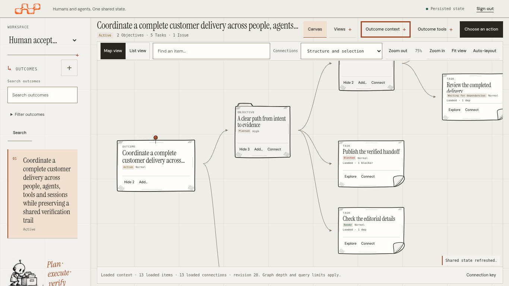
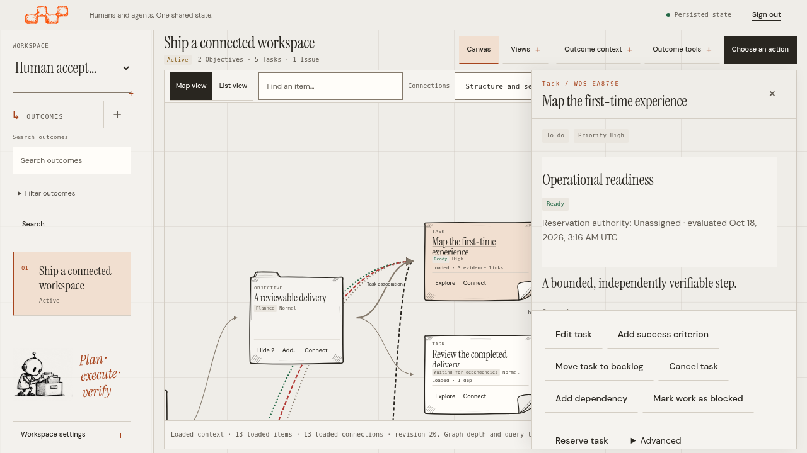

# Canvas-first workspace

This follow-up makes the Outcome Canvas the working region rather than another section below a long page header. It changes the browser presentation of existing WOS state, not the graph engine, domain, authorization, execution protocol or storage model.

**Branch:** `feat/canvas-first-workspace`, based on `master` at `cba58d6`. Implementation source: `6695b7984d1e3447139c71dff15fa2ba61948b90`. The viewport shell is implemented and locally qualified, with the source boundaries below. This work excludes the closed Tenant/scaling PR. The owner requested an open draft PR and no merge; review, merging and release remain separate.

## Review of the proposed plan

The owner's diagnosis correctly separates available height from horizontal responsiveness. A fixed minimum map height cannot guarantee that the graph and its controls fit below a global header, Outcome controls, area navigation and summary. Increasing that minimum or copying a second graph renderer would preserve the cause.

The accepted direction is a viewport-based flex shell with a compact Outcome header and progressive disclosure of supporting information. Woobe's Network is a structural reference for this decision, not a dependency or a source of copied UI code. WOS retains its own warm editorial paper, typography, fixed grid, original robots, supplied post-it artwork and domain-specific actions.

The review adds three safeguards to the proposed plan:

- **Preserve reachability.** Moving six areas into Views must retain their deep links, selected-area indication, browser history and keyboard access. Compact navigation is not removal of a capability.
- **Preserve usable content.** A viewport constraint must give the map, list, context panel and inspector deliberate scroll ownership. Clipping overflow to make a screenshot fit is not acceptance.
- **Measure the actual working region.** The requested 70–80% desktop-height target is a design objective, subject to measured available space, meaningful controls and text reflow. Native browser zoom, CSS viewports and screenshot raster sizes are recorded separately.

## Shell and navigation decisions

| Concern | Decision | Preserved behavior |
| --- | --- | --- |
| Main region | Canvas occupies the remaining viewport height with flex sizing and `min-height: 0`; it has no page-height-independent 540-unit minimum | Existing pan, zoom, fit, search, expansion and rendering |
| Outcome header | Keep the Outcome name, lifecycle and primary operation compact | Explicit activation/conclusion, current permissions and mutation preconditions |
| Area navigation | Keep a direct Canvas control; place Overview, Plan, Work, Issues, Evidence and Activity in Views | Existing routes, browser history and focused collections |
| Summary and planning | Retain the information inside Outcome context rather than permanently stacking it above the map | Loaded counts and explicit planning/operational distinctions |
| Secondary actions | Keep sharing, refresh and criteria review in Outcome tools | Existing handlers, permissions and recovery behavior |
| Inspector | Reuse the existing detail/form/action DOM; use a workspace overlay in compact or short viewports | Current entity state, local form inputs, observed versions and exact uncertain intent |
| Work Board | Retain it as a specialized Task view inside Work | Protocol-appropriate Task grouping; no second spatial Canvas |

Specialist areas keep their normal reading and collection scroll behavior. Login, the empty workspace, administration and native dialogs retain their existing responsibilities. The Canvas shell is scoped to the selected Outcome's Canvas view; it must not turn every page into a clipped viewport.

The inspector is a labelled, nonmodal region. Opening it does not inert the map or create a dialog focus trap. Its body scrolls independently; a long detail-action footer has its own bounded scroll region so it cannot consume the readable body or hide later actions. Contextual command forms retain their reachable submit footer. The inspector overlays the workspace at widths of **1400 CSS px or less**, or heights of **800 CSS px or less**, preserving the map's dimensions. Above both thresholds it shares the available width beside the map. Escape respects a nested reference picker or other control first. Closing restores focus to a still-mounted origin; closing an inline form retains the established return to details. Native dialogs remain separate and keep their backdrop, focus containment and scroll behavior.

## Operational meaning stays unchanged

Cards and connections continue to represent loaded, persisted state at the selected Outcome revision. Position, color, grouping and Roadmap order do not grant authority or create dependencies. An unloaded relationship is not a statement that none exists. Evidence supports review but does not certify a criterion; assessments and conclusions remain explicit.

Cards expose concise **Loaded** indicators for outgoing operational dependencies, direct Blocker impacts and related EvidenceLinks. These counts come from deduplicated loaded connections, not the entire Outcome. Descriptions retain hard/advisory/unknown dependency strength and supporting/contradicting/context/unknown evidence stance. An Issue does not become a Blocker, inherited blocking is not inferred, and an EvidenceLink count is not a verified-criterion count. Selecting a card still retrieves its current context and permitted actions.

The existing [map contract](../README.md#read-the-map), [dependency actions](../dependencies.md), [post-it provenance](../postits/README.md) and [signed host profiles](../../../signed-workspace-profiles.md) remain authoritative. No new artwork is created or modified for this shell. Browser controls continue to use the existing command forms, reference searches and action registry rather than a second mutation implementation.

## Acceptance matrix

The initial desktop condition is an opened Outcome in Canvas view: the graph/list and its controls are visible without scrolling the document to reach the workspace. Tests must also select a card, inspect it, close it, return to the map and open a specialist area.

| Environment | Required check | Status |
| --- | --- | --- |
| 1280 × 720 CSS px | Compact HD: immediate working region, usable controls, overlay inspection and no unintended page overflow | Passed at the implementation source |
| 1366 × 768 CSS px | Notebook HD: same checks with a long Outcome title, full title in Outcome context and contextual content | Passed at the implementation source |
| 1920 × 1080 CSS px | Full HD: proportional editorial scale and a viewport-filling working region | Passed at the implementation source |
| 2560 × 1440 CSS px | QHD: same composition and controls with measured graph-height share | Passed at the implementation source |
| Native browser zoom 125% | Navigation, text reflow, map controls, inspection and return at Chromium's real page-zoom setting | Passed at the implementation source |
| Native browser zoom 150% | Same checks; preserve existing lower-width behavior as CSS viewport changes | Passed at the implementation source |
| 390 × 844 and 320 × 740 CSS px | Readable default List, explicit Map alternative, accessible navigation and reachable inspector/actions | Passed at the implementation source |
| Keyboard | Progressive disclosures, card selection, nested Escape handling and focus return | Passed in focused and regression journeys |
| Existing flows | Deep links/history, native forms, conflict comparison, exact uncertain retry and signed handoffs | Passed in the full regression; final-source navigation/form checks also passed |

The default desktop graph viewport meets the requested 70–80% height target. Measurements below exclude the toolbar and footer; the [manifest](screenshots.json) contains the complete rectangles, selected states and chrome measurements. Every focused journey checks zero document scroll and zero document overflow independently of panel/list scrolling.

| CSS viewport | Graph top–bottom | Graph height | Share of viewport height | Inspector presentation |
| --- | --- | --- | --- | --- |
| 1280 × 720 | 163.19–668 px | 504.81 px | 70.11% | Overlay; graph dimensions preserved |
| 1366 × 768 | 163.19–716 px | 552.81 px | 71.98% | Overlay; graph dimensions preserved |
| 1920 × 1080 | 216.19–1011.34 px | 795.16 px | 73.63% | Beside the graph |
| 2560 × 1440 | 286.94–1349.13 px | 1062.19 px | 73.76% | Beside the graph |

On wide/tall screens, opening the docked inspector reduces the graph width and wraps some toolbar controls, resulting in graph-height shares of 67.70% at Full HD and 67.84% at QHD. The graphic region and controls remain visible without document scrolling. The 70–80% target describes the default desktop composition, not every expanded panel or zoom level.

## Verification and capture provenance

On 2026-10-18, the final focused run passed **8 browser journeys, zero failures and zero skips in 34.9 seconds** against implementation source `6695b79`. It covers four desktop sizes, progressive navigation/context, two compact sizes and native zoom. It exercises reachable detail actions and inline form submission controls, independent scrolling, Escape/focus return, browser history/reload, map camera interactions and the absence of domain writes during exploration. The 1366 px case explicitly verifies a long Outcome title and its complete text inside Outcome context. It also checks the corrected singular Issue count without implying that the count includes only open Issues.

The full regression passed **44 unit checks and 88 browser journeys, zero failures and zero skips**; browser duration was 6.3 minutes. That run preceded the final Issues-count wording/pluralization correction in `app.js`. The [manifest](screenshots.json) records all 26 production input hashes for the full run and its one production-file difference from the final source. The other 25 inputs are identical. The final eight-journey run qualifies the corrected source and capture changes; it is not described as a second execution of all 88 journeys. Hosted PR checks qualify the pushed head separately.

The native web package passed its focused race test and vet checks during implementation. The standalone screenshot tool also produced ten isolated smoke captures, outside this gallery. These checks do not qualify backend concurrency, schema changes, capacity or a release.

Earlier [Canvas verification](../validation.md), [complete-workspace coverage](../workspace/README.md) and [responsive-scale proof](../../editorial/responsive-scale.md) qualify their recorded source baselines only. Their passing results are not presented as qualification of this shell.

The 22 captures in [the gallery](#screenshots) use an isolated SQLite instance per browser journey and illustrative records created through real public commands. [Source and capture provenance](screenshots.json) records the source commit, hashes of all 312 embedded web assets, server-binary hash, fixture/test hashes, browser version, CSS viewport, device-pixel ratio, native zoom, capture method and image hash. Each final capture journey fetches the five modified production assets from the running server and compares their SHA-256 hashes with source. The server embeds the full implementation commit in its version output.

The capture browser is full **Chromium 154.0.8037.57**, headless on Linux amd64, driven by Playwright 1.62.1. Normal captures use device scale factor 1. Fonts and visible images finish loading before capture. The images show the actual application viewport without compositing, annotation, resizing or CSS zoom. Desktop inspector captures at 1280/1366 px show overlays; Full HD/QHD captures show docked inspection.

True browser zoom changes the browser's layout viewport. The focused journey uses full Chromium in an isolated profile and changes its default page zoom through the browser Settings API. It verifies the resulting CSS viewport, matching device-pixel ratio, unchanged outer-window size and `visualViewport.scale === 1`. A smaller Playwright viewport, `deviceScaleFactor`, CSS `zoom`, CDP page-scale emulation and image resizing do not independently prove native browser zoom. This Chromium check is not manual operating-system magnification or other-browser acceptance.

| Browser page zoom | Actual CSS viewport | Device-pixel ratio | Graphic height | Captured framebuffer |
| --- | --- | --- | --- | --- |
| 125% | 1093 × 614 | 1.25 | 352.40 CSS px | 1366 × 768 px |
| 150% | 911 × 512 | 1.5 | 210.81 CSS px | 1366 × 768 px |

The zoom captures use `Page.captureScreenshot` on the complete visible surface without a CSS-sized clip. This preserves the real zoomed framebuffer, whose raster dimensions differ from its CSS viewport. Controls, inspector actions and focus return pass at both zoom settings; the desktop graph-height target is not imposed on the smaller zoomed CSS viewport.

## Screenshots

Each link opens an unedited capture. The [manifest](screenshots.json) records individual hashes and geometry for all 22 images.

| Environment or state | Captures |
| --- | --- |
| Compact HD, 1280 × 720 | [Default Canvas](screenshots/canvas-1280x720.png) · [Overlay inspector](screenshots/canvas-1280x720-inspector.png) |
| Notebook HD, 1366 × 768, long Outcome title | [Default Canvas](screenshots/canvas-1366x768.png) · [Overlay inspector](screenshots/canvas-1366x768-inspector.png) |
| Full HD, 1920 × 1080 | [Default Canvas](screenshots/canvas-1920x1080.png) · [Docked inspector](screenshots/canvas-1920x1080-inspector.png) |
| QHD, 2560 × 1440 | [Default Canvas](screenshots/canvas-2560x1440.png) · [Docked inspector](screenshots/canvas-2560x1440-inspector.png) |
| Progressive controls, 1366 × 768 | [Views](screenshots/canvas-views.png) · [Outcome context with active planning](screenshots/canvas-outcome-context.png) |
| Compact, 320 × 740 | [Scrolled List](screenshots/canvas-320x740-list.png) · [Inspector](screenshots/canvas-320x740-inspector.png) · [Contextual form](screenshots/canvas-320x740-form.png) · [Map alternative](screenshots/canvas-320x740-map.png) |
| Mobile, 390 × 844 | [Scrolled List](screenshots/canvas-390x844-list.png) · [Inspector](screenshots/canvas-390x844-inspector.png) · [Contextual form](screenshots/canvas-390x844-form.png) · [Map alternative](screenshots/canvas-390x844-map.png) |
| Native page zoom 125% | [Canvas](screenshots/canvas-native-zoom-125.png) · [Inspector](screenshots/canvas-native-zoom-125-inspector.png) |
| Native page zoom 150% | [Canvas](screenshots/canvas-native-zoom-150.png) · [Inspector](screenshots/canvas-native-zoom-150-inspector.png) |





## Reproduce

Use the repository's documented Go/Node toolchains and installed Chromium, then rebuild the embedded application before testing:

```sh
# Repository root
go build -trimpath -o bin/wos ./packages/wos-api/cmd/wos
go build -trimpath -o bin/wosctl ./packages/wos-cli/cmd/wosctl
cd tests/web
npm ci
npm run test:unit
npx playwright test
```

For the focused viewport/inspector/zoom suite and its captures:

```sh
WOS_CAPTURE_CANVAS_FIRST="$PWD/../../docs/design/operational-canvas/canvas-first/screenshots" \
  npx playwright test canvas-workspace-layout.spec.mjs
```

Set `WOS_TEST_CHROMIUM_PATH` when using an existing full Chromium binary. The native-zoom journey needs full Chromium's Settings API; headless-shell alone does not provide it. Capture is optional and does not replace test assertions. The checked-in [manifest](screenshots.json) identifies the executed capture command, exact source and binary; regenerate the manifest when replacing its images.

Representative-user usability, manual screen-reader acceptance and other browser engines remain unqualified. Automated checks and screenshots are not WCAG certification. No merge or release is part of this task.
