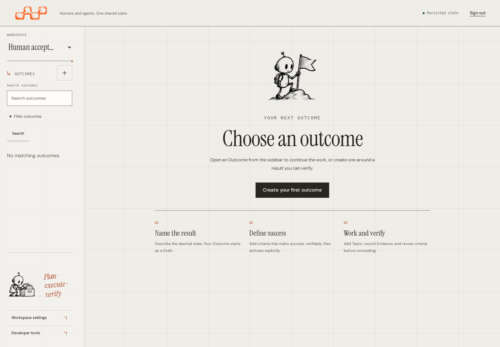
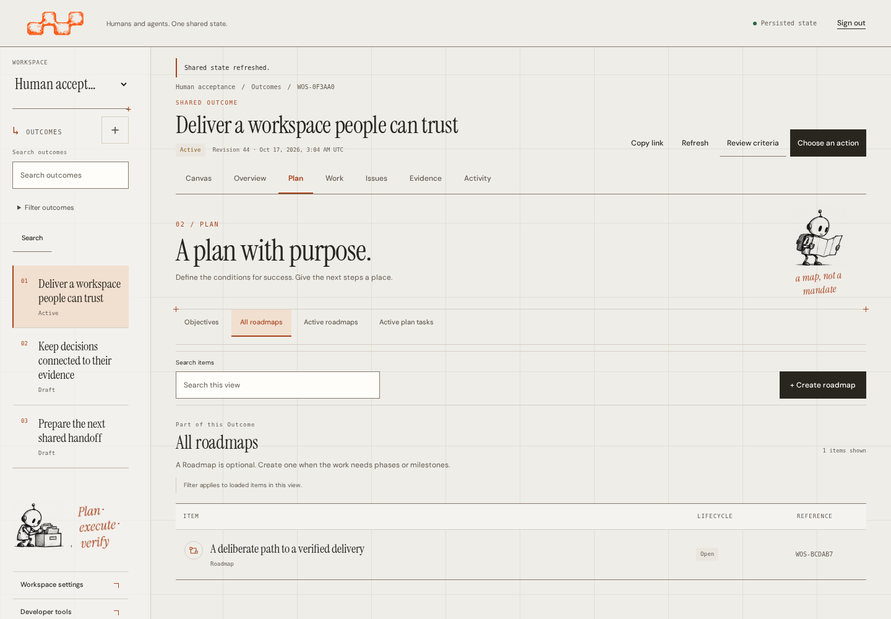
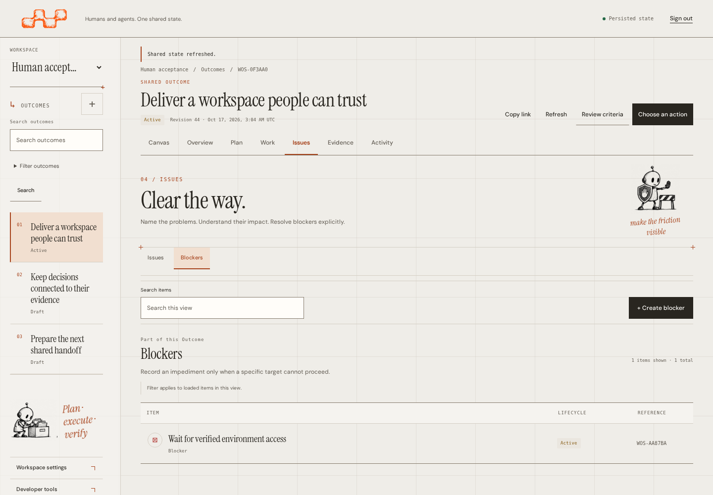
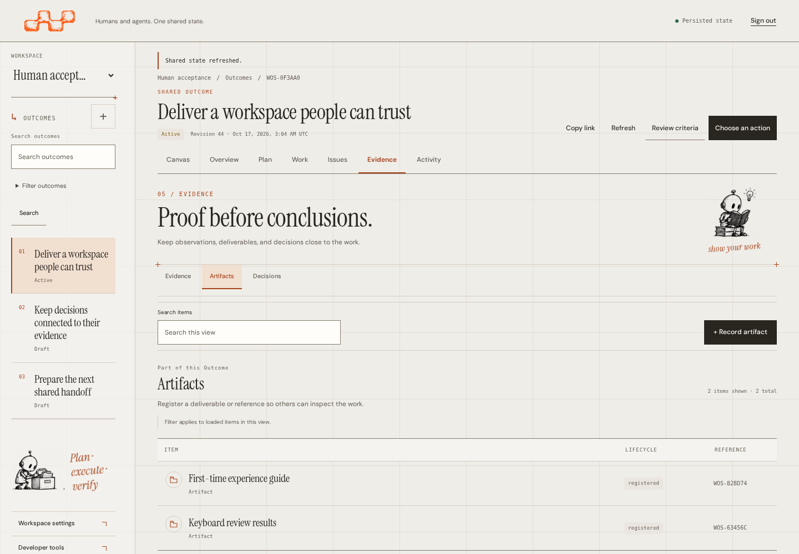
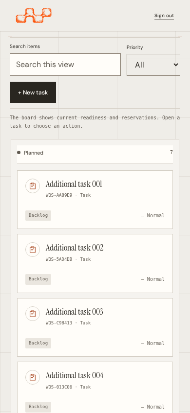
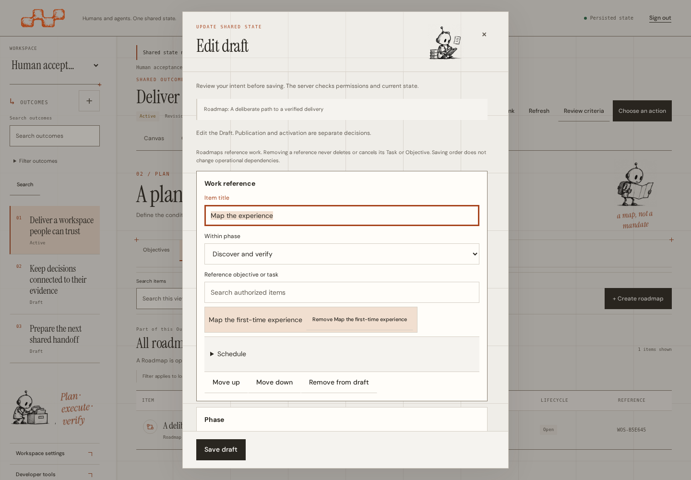
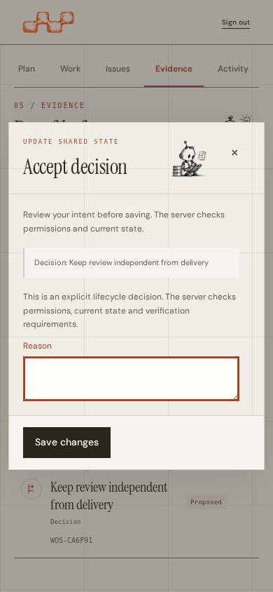
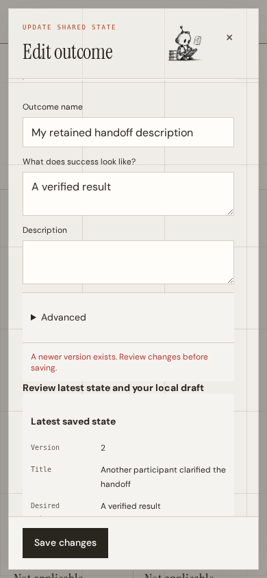

# Editorial workspace pages

The focused workspace areas, sign-in, navigation, entry states and native dialogs extend the same editorial identity as the operational Canvas. This refinement makes each collection explain its purpose, exposes the relevant record metadata and gives empty, loading and error states a useful next step. It reuses the existing authenticated reads, commands, permissions and forms; it introduces no domain model, execution runtime or alternate mutation path.

For operation, see the [human workspace guide](../../../workspace-ux.md). The [Canvas guide](../README.md) covers the map and inspector. Executed checks, capture provenance and remaining acceptance limits belong to the [verification record](../validation.md).

## Page and state coverage

| Surface | Included views and behavior | Captures |
| --- | --- | --- |
| Sign-in | Existing credential form with administrator guidance, a separate local-server disclosure and session/access explanation | [Desktop](../../editorial/screenshots/01-login.png) · [Mobile](screenshots/03-mobile-login.png) |
| Sidebar | Native Workspace selector, visible Outcome search label, lifecycle/archive filters, numbered Outcome navigation, mobile disclosure and permission-gated settings/tools | [Desktop navigation](../../editorial/screenshots/19-fixed-paper-top.png) · [Mobile navigation](../../editorial/screenshots/21-mobile-outcome-navigation.png) |
| Empty workspace | Choose an existing Outcome or create a Draft; the short guide explains criteria, explicit activation, bounded work and review | [Desktop](screenshots/03-desktop-empty-workspace.png) · [Mobile](screenshots/03-mobile-empty-workspace.png) |
| Overview | Desired result, progress and denominators, preparation checklist, suggested next step and Task summary | [Desktop](../../editorial/screenshots/02-overview.png) · [Mobile](../../editorial/screenshots/12-mobile-overview.png) · [Draft setup](screenshots/03-mobile-draft-setup.png) |
| Plan | Objectives, All roadmaps, Active roadmaps and Active plan tasks; hierarchy, Draft/revision state and operational references remain distinct | [Objectives](screenshots/01-mobile-objectives.png) · [Roadmaps](screenshots/01-desktop-roadmaps.png) · [Mobile Roadmaps](screenshots/01-mobile-roadmaps.png) · [Active plan references](screenshots/01-desktop-plan-references.png) |
| Work | All Tasks and protocol-appropriate status subsets, List and Board, relevant priority filters and explicit current-authority guidance | [Desktop List](../../editorial/screenshots/04-work.png) · [Desktop Board](../../editorial/screenshots/05-work-board.png) · [Mobile List](../../editorial/screenshots/13-mobile-work.png) · [Mobile Board](screenshots/01-mobile-board.png) |
| Issues | Issues record problems; Blockers record separate impacts on explicit targets | [Desktop Issues](../../editorial/screenshots/06-issues.png) · [Mobile Issues](screenshots/01-mobile-issues.png) · [Desktop Blockers](screenshots/01-desktop-blockers.png) · [Mobile Blockers](screenshots/01-mobile-blockers.png) |
| Evidence | Evidence, Artifacts and Decisions have their own guidance, metadata and permitted actions | [Desktop Evidence](../../editorial/screenshots/07-evidence.png) · [Mobile Evidence](screenshots/01-mobile-evidence.png) · [Desktop Artifacts](screenshots/01-desktop-artifacts.png) · [Mobile Artifacts](screenshots/01-mobile-artifacts.png) · [Desktop Decisions](screenshots/01-desktop-decisions.png) · [Mobile Decisions](screenshots/01-mobile-decisions.png) |
| Activity | Recorded Activity, Contested conclusions and Relations; readable event groups and typed connections preserve their separate meanings | [Desktop Activity](../../editorial/screenshots/08-activity.png) · [Mobile Activity](screenshots/01-mobile-timeline.png) · [Desktop contestations](screenshots/01-desktop-contested-conclusions.png) · [Mobile contestations](screenshots/01-mobile-contested-conclusions.png) · [Desktop Relations](screenshots/01-desktop-relations.png) · [Mobile Relations](screenshots/01-mobile-relations.png) |
| Pending and failed reads | Current-context loading explains the read; failed reads retain an explicit refresh/reload action rather than implying an empty collection | [Pending Outcome](screenshots/03-mobile-loading.png) · [Read error](screenshots/03-desktop-read-error.png) |
| Detail and action dialogs | Native detail, criteria and permitted-action surfaces keep their focus, backdrop, scroll and close behavior | [Task detail](../../editorial/screenshots/09-task-detail.png) · [Artifact detail](screenshots/02-desktop-artifact-detail.png) · [Decision detail](screenshots/02-desktop-decision-detail.png) · [Blocker detail](screenshots/02-mobile-blocker-detail.png) · [Criteria](screenshots/02-desktop-criteria.png) · [Action menu](../../editorial/screenshots/16-action-menu.png) |
| Contextual forms and planning | Existing form commands, typed reference pickers, nested editors and persistent save actions; Draft editing, revision publication and activation remain separate | [Task form](../../editorial/screenshots/10-task-form.png) · [Evidence form](screenshots/02-mobile-evidence-form.png) · [Decision form](screenshots/02-mobile-decision-form.png) · [Roadmap detail](screenshots/02-desktop-roadmap-detail.png) · [Desktop Roadmap form](screenshots/02-desktop-roadmap-form.png) · [Mobile Roadmap form](screenshots/02-mobile-roadmap-form.png) · [Publication review](screenshots/02-desktop-roadmap-publication.png) |
| Settings | Authorized grant, credential and Workspace operations remain in the native administration dialog | [Credential issuance](screenshots/02-desktop-settings-issue-credential.png) · [Workspace creation](screenshots/02-mobile-settings-create-namespace.png) |
| Technical tools | Permission-gated schema/command controls retain their technical role outside the common creation flow | [Technical Decision command](screenshots/02-desktop-technical-decision.png) |
| Conflict and uncertain writes | Compare retained edits with current state before choosing a fresh intent; uncertain responses freeze the original payload and idempotency key for exact retry | [Conflict](screenshots/04-mobile-conflict.png) · [Comparison](screenshots/04-mobile-conflict-comparison.png) · [Uncertain intent](screenshots/04-mobile-uncertain-intent.png) |

The Plan matrix includes Active roadmaps even though this supplemental gallery has no separate capture for that subtab. The presentation journey visits it on desktop and mobile. The [existing editorial gallery](../../editorial/README.md#main-pages) supplies the main views; the 40 supplemental captures above cover additional collections, forms and states. An image shows one viewport, not the entire page or every available action.

## Search, state and authority

**All Tasks in List view** searches the authorized Task collection for the selected Outcome on the server, with priority filtering and pagination. Outcome discovery also queries the server. Other collection filters search their loaded records, including Activity and Relations; their scope is stated beside the controls. In legacy lease mode, Board columns retain the server's derived readiness groups. In contract modes, columns describe the persisted lifecycle of loaded Tasks and explicitly require selecting a Task for current authority. Load more includes another bounded page. A filter with no matches offers Clear filters; it does not establish that no other records exist.

Read counts, empty guidance and typed metadata do not infer authority. In contract modes, open a Task to inspect its current execution and review context. Persisted lifecycle, a legacy lease projection or a Board position does not grant permission to execute. Signed execution and independent review handoffs use an authorized external CLI host profile. The browser holds no signing key and cannot sign, accept a host contract or decide an independent review for that host. See [signed profiles and recovery](../../../signed-workspace-profiles.md).

Contract-mode List filters expose All Tasks, Done and Cancelled. Legacy readiness options remain available in legacy mode. An older contract-Workspace link to a legacy readiness group opens All Tasks with an explanation and a corrected URL; it does not present an expired legacy lease as current signed attention.

Evidence is an observation, an Evidence link records a stance, and a criterion assessment evaluates a particular definition revision. Task completion does not achieve an Objective or Outcome. Resolving an Issue does not release a Blocker. Roadmap ordering does not create operational dependencies. These boundaries remain visible in guidance and existing action flows.

## Identity and native interaction

The fixed editorial grid, warm paper tokens, Instrument Serif, DM Sans and monospace metadata remain shared across pages. Modal headers, bodies and footers use the existing canvas/workspace/surface roles and border tokens. Inputs and highlighted records retain warm surfaces. Buttons retain padded hover/focus states and touch-sized controls; typography and dimensions continue to use the existing responsive unit above the 1440 CSS px reference.

The original hand-drawn chain is the only header logo. The supplied robots, including the blank-map planner on sign-in, are unchanged and retain their original proportions and transparency. No new artwork, recoloring or duplicate brand mark is introduced. The [art and brand provenance](../../editorial/README.md#illustration-direction-and-provenance) and [post-it provenance](../postits/README.md) remain separate from product instructions.

Detail, action, command and administration dialogs preserve native focus containment, Escape, backdrop and scrolling. Nested reference/editor controls retain their own keyboard behavior. Common forms use the same canonical commands and authenticated authorship: Artifact registration records a deliverable; proposing a Decision does not accept it. Version conflicts require an explicit comparison, and uncertain responses keep the exact recoverable intent. This presentation does not relax server permissions, expected versions, leases, signed authority or receipts.

## Selected views

These examples use illustrative records created through public commands on isolated local servers. Supplemental desktop captures use 1440 × 1000 CSS px; mobile captures use 390 × 844. The capture helper waits for fonts and visible images, disables screenshot animations and records the viewport without compositing artwork.

| Starting work | Planning |
| --- | --- |
|  |  |

| Operational impacts | Deliverables |
| --- | --- |
|  |  |

| Mobile work | Native planning form |
| --- | --- |
|  |  |

| Explicit Decision proposal | Conflict comparison |
| --- | --- |
|  |  |

## Reproduce

Use the repository's documented Go and Node toolchains. Rebuild the embedded web assets before running the real-server browser journeys:

```sh
# Repository root
go build -trimpath -o bin/wos ./packages/wos-api/cmd/wos
cd tests/web
npm ci
WOS_PRESENTATION_SCREENSHOTS="$PWD/../../docs/design/operational-canvas/workspace/screenshots" \
  npx playwright test presentation.spec.mjs
```

The [presentation journey](../../../../tests/web/presentation.spec.mjs) defines all 40 supplemental filenames. Its fixtures create real records and exercise reads, native forms, publication review, conflict comparison and exact uncertain retry. An installed Chromium can be selected with `WOS_TEST_CHROMIUM_PATH`; other setup requirements are in [verification](../validation.md#reproduce).

Regenerate the inherited main-page captures separately with `WOS_DESIGN_SCREENSHOTS` and `editorial.spec.mjs`, as described in the [editorial reproduction guide](../../editorial/README.md#reproduce-and-validate). Use [verification](../validation.md) for executed results and limits. Automated checks and screenshots do not establish representative-user usability, manual screen-reader acceptance, native browser zoom coverage or WCAG certification.
