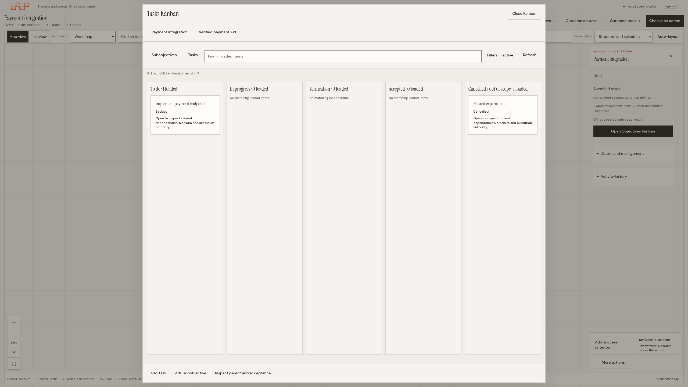
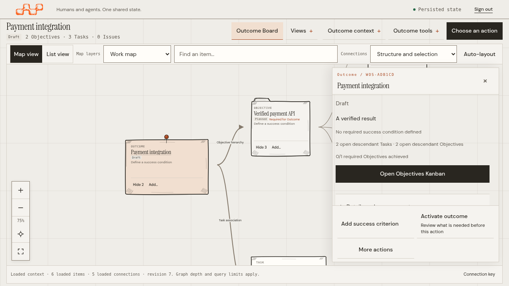
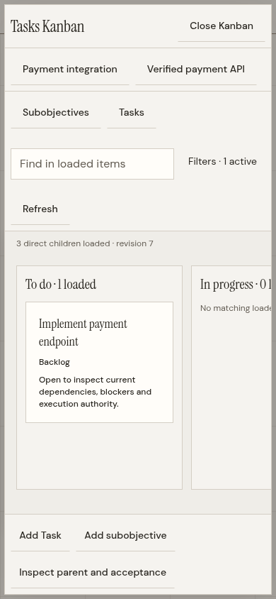

# Contextual Kanbans — application captures

These are unmodified browser viewport captures of the running application, using
synthetic planning records. Each PNG has a paired JSON receipt: exact source and
binary commit, binary checksum, browser version, viewport/pixel dimensions, test
checksum and SHA-256 of every served CSS, JavaScript and HTML entry asset.

Source: `356c5e650027d7e5ca703fa3c4494133ccb87e30`. Later documentation commits
retain these receipts rather than relabelling them as a different source.
[Manifest](manifest.json) · [Qualification](../qualification.md) · [Operation](../README.md).

## Desktop

[](356c5e650027/kanban-2560x1440.png)

The Objective's Tasks and cancelled history occupy distinct columns. Filtering,
navigation and creation stay separate from lifecycle commands.

[](356c5e650027/inspector-1280x720.png)

The Board remains the workspace; selecting an Outcome reveals the compact summary
and a single Open Objectives Kanban action.

## Narrow screens

<a href="356c5e650027/kanban-390x844.png"></a>

Columns keep a readable width with horizontal navigation; the dialog contains
its own scroll. This is browser viewport evidence, not a physical-device test.

## Full capture index

| CSS viewport | Compact inspector | Objectives | Tasks and cancellations |
| --- | --- | --- | --- |
| 1024 × 768 | [Inspector](356c5e650027/inspector-1024x768.png) | [Objectives](356c5e650027/objectives-1024x768.png) | [Tasks](356c5e650027/kanban-1024x768.png) |
| 1280 × 720 | [Inspector](356c5e650027/inspector-1280x720.png) | [Objectives](356c5e650027/objectives-1280x720.png) | [Tasks](356c5e650027/kanban-1280x720.png) |
| 1366 × 768 | [Inspector](356c5e650027/inspector-1366x768.png) | [Objectives](356c5e650027/objectives-1366x768.png) | [Tasks](356c5e650027/kanban-1366x768.png) |
| 1920 × 1080 | [Inspector](356c5e650027/inspector-1920x1080.png) | [Objectives](356c5e650027/objectives-1920x1080.png) | [Tasks](356c5e650027/kanban-1920x1080.png) |
| 2560 × 1440 | [Inspector](356c5e650027/inspector-2560x1440.png) | [Objectives](356c5e650027/objectives-2560x1440.png) | [Tasks](356c5e650027/kanban-2560x1440.png) |
| 3840 × 2160 | [Inspector](356c5e650027/inspector-3840x2160.png) | [Objectives](356c5e650027/objectives-3840x2160.png) | [Tasks](356c5e650027/kanban-3840x2160.png) |
| 390 × 844 | [Inspector](356c5e650027/inspector-390x844.png) | [Objectives](356c5e650027/objectives-390x844.png) | [Tasks](356c5e650027/kanban-390x844.png) |
| 320 × 740 | [Inspector](356c5e650027/inspector-320x740.png) | [Objectives](356c5e650027/objectives-320x740.png) | [Tasks](356c5e650027/kanban-320x740.png) |
| 430 × 932 | [Inspector](356c5e650027/inspector-430x932.png) | [Objectives](356c5e650027/objectives-430x932.png) | [Tasks](356c5e650027/kanban-430x932.png) |

Additional contextual states: [Criteria review](356c5e650027/verify-criteria.png)
and [Add material](356c5e650027/add-material.png).

Reproduce after a source-stamped build and a clean production/test worktree:

```sh
cd tests/web
WOS_TEST_CHROMIUM_PATH=/usr/bin/chromium \
WOS_CAPTURE_CONTEXTUAL_KANBAN="$PWD/../../docs/ux/contextual-kanban/screenshots" \
npx playwright test contextual-kanban.spec.mjs --workers=1
```

The capture helper refuses mismatched source/binary/served assets and existing
filenames. Use another output directory to repeat the same revision.
