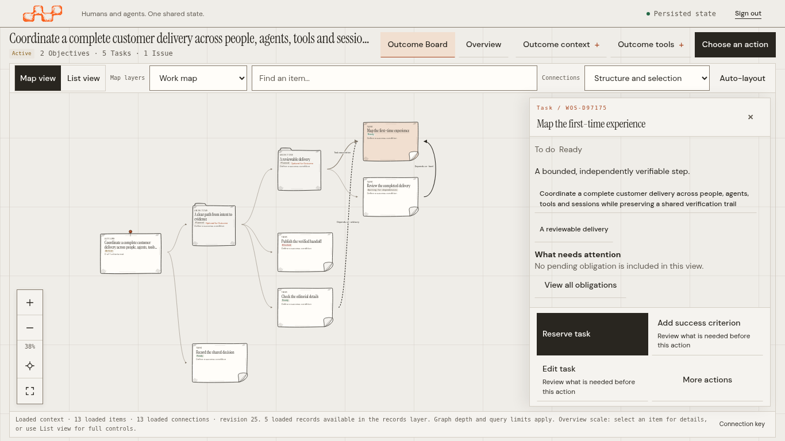
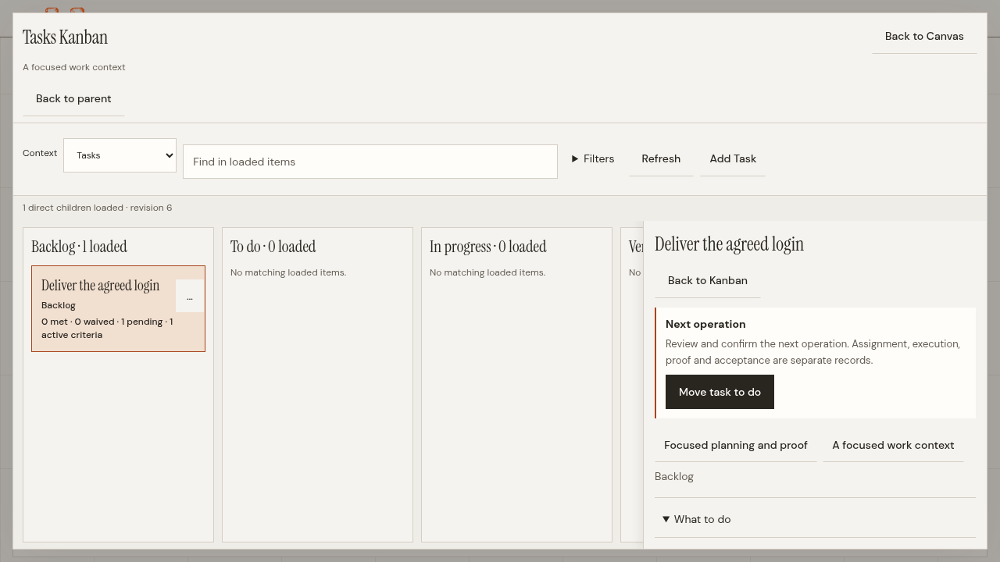
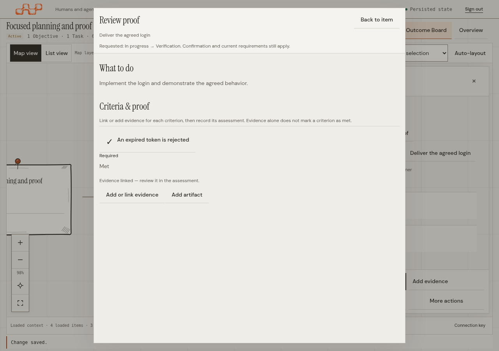

# Focused modal Kanban — source-bound captures

The subsequent drag-only follow-up removes the card ellipsis/stage menu visible
in these captures. These receipts retain their recorded runtime source; they
are not new captures of that follow-up.

Real browser captures from runtime source
`fa82060cf661415d2253f32ac11dedfbf54296e1`, using public commands in an isolated
test installation. Seven passing capture scenarios verify the actual served assets
against source (44 assets for each modal capture, seven for the Board capture). These images show the existing editorial identity, not mockups.

| Surface | CSS viewport | Capture |
|---|---|---|
| Outcome Board and selected Task | 1366×768 | [Board](board-1366.png) |
| Objectives Kanban and selected Objective | 2560×1440 | [Objectives](objectives-2560.png) |
| Tasks Kanban and selected Task | 1280×720 | [HD](kanban-1280.png) |
| Tasks Kanban and selected Task | 2560×1440 | [QHD](kanban-2560.png) |
| Tasks Kanban and selected Task | 3840×2160 | [4K](kanban-3840.png) |
| Tasks Kanban and selected Task | 390×844 | [Mobile](kanban-390.png) |
| Criterion checklist after explicit assessment | 1280×900 | [Review proof](review-proof.png) |

Each PNG has a neighboring JSON receipt recording its source, stamped server
metadata, viewport, browser, served asset hashes and image hash. The
[manifest](manifest.json) also binds the actual local server binary. Later
documentation-only commits do not change this runtime or the tested assets.
No live credentials or customer data are included.

The Kanban is a native modal above the mounted spatial Board. Operations replace
it instead of stacking dialogs. Context selects the collection and its create
action. The selected-item inspector omits the action directory and technical audit;
on mobile it paints above lane controls, which cannot intercept its pointer input.

Review proof keeps instructions and the existing criteria checklist. Evidence can
be added or reused for a criterion, and Artifacts remain optional. Only a current,
explicit `met` Assessment checks the criterion; no Evidence link accepts work.
Complete long instructions can be read at the same Outcome revision without an
audit panel. Native browser zoom is covered by separate 125–400% browser tests.
Physical-device and manual assistive-technology acceptance are not established by
these viewport captures.

[Operate the interface](../../README.md) · [Decisions and audit](../../simplification.md)
