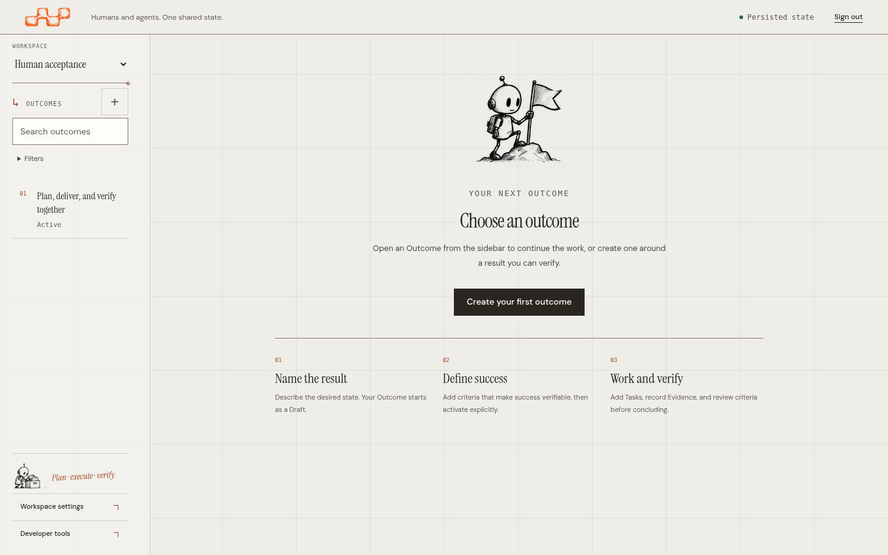
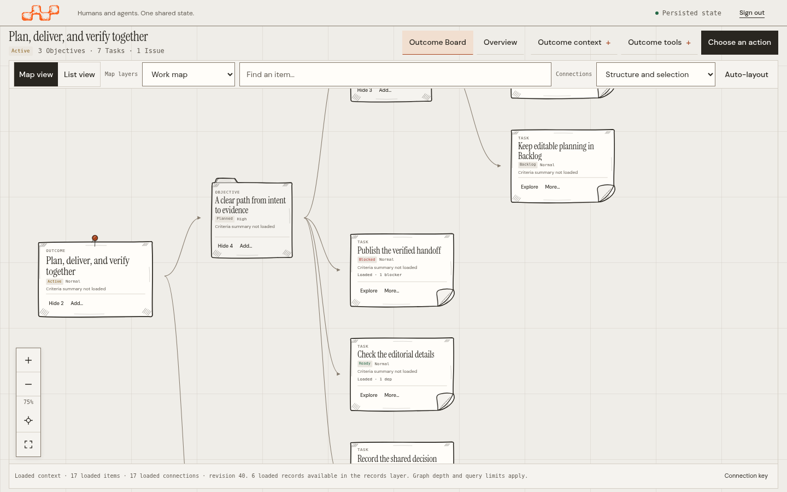
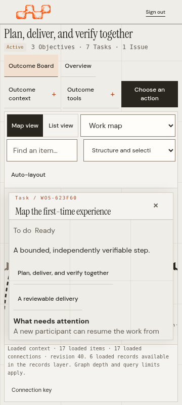
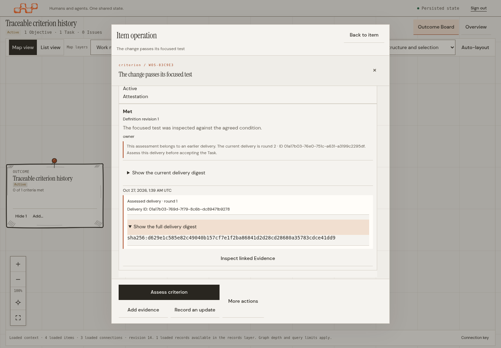
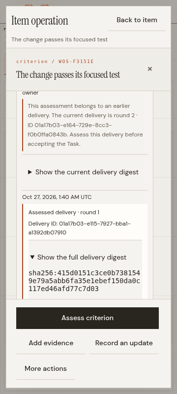
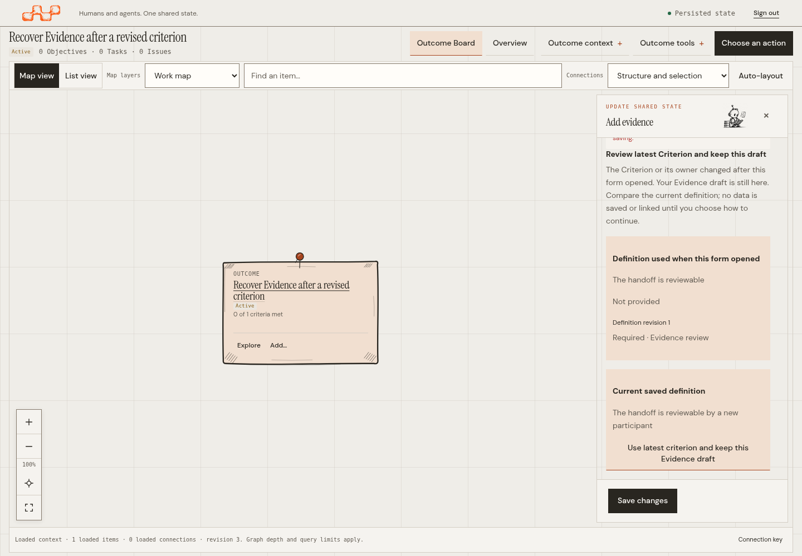
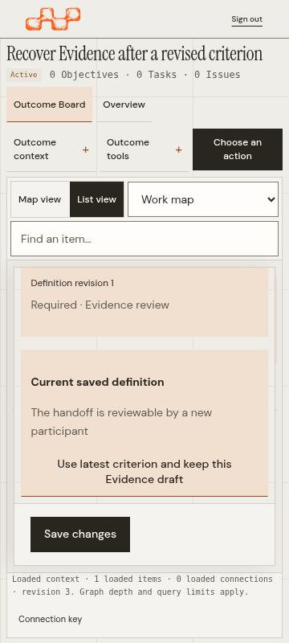
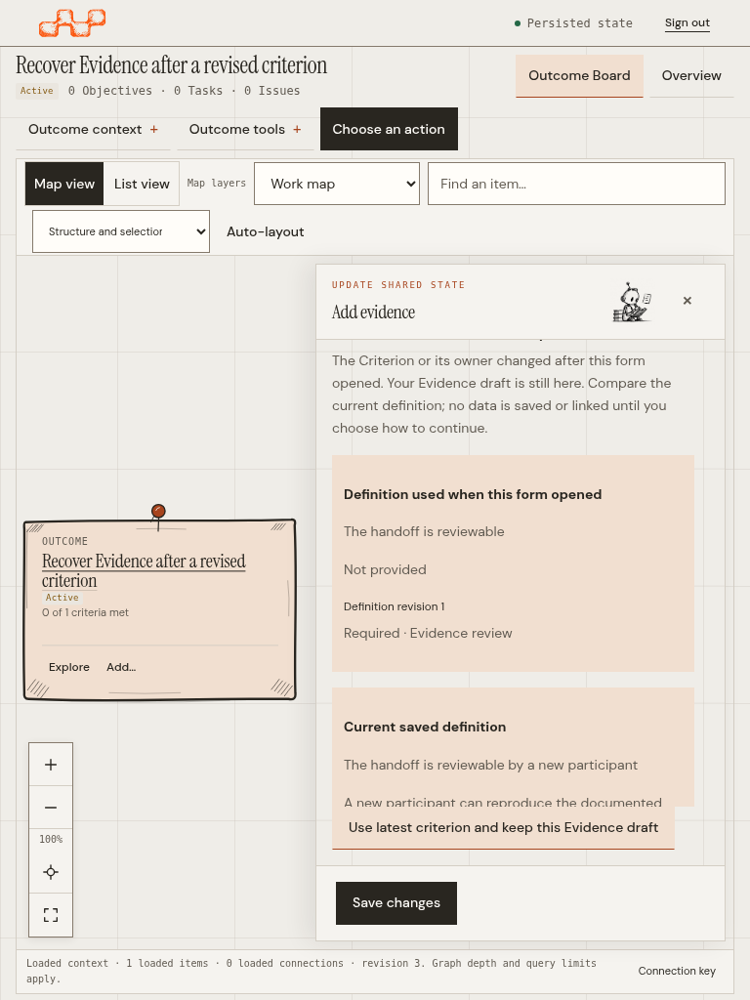
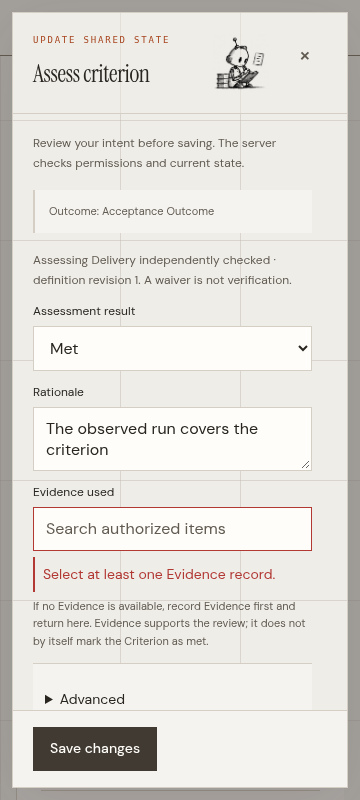
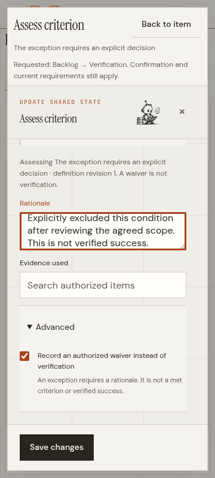

# Product UX review — 2026-10-26

Verification updated 2026-10-27.

This is a bounded, evidence-backed product iteration, not a declaration that the full WOS audit is complete. PR #116 had already merged as `840292c` before the newer work in this branch was pushed; no merge or release was performed for these changes. The follow-up is reviewable in [Draft PR #117](https://github.com/A1b3rt0M3rcad0/wos/pull/117) on `fix/workspace-operational-density`.

## Method and evidence

The review used the installed `laws-of-ux-auditor` and `product-design-and-ux` skills, inspected client navigation/state code and domain-backed browser fixtures, and exercised WOS in Chromium against an isolated SQLite database. `agent-browser` was not available, so Playwright drove Chromium. The original gallery remains source-bound to [`be6eb6e`](https://github.com/A1b3rt0M3rcad0/wos/commit/be6eb6eebbeb4fcdec31010e9eecbd4de31621fd). The latest criterion-history and Evidence-conflict screenshots are separately bound to the checked-out frontend source commit and record the API binary hash and exact browser asset delivery mode; see their JSON sidecars.

Findings use **Observed** for behavior reproduced in the running product, **Inferred** for a risk derived from inspected code or test design, and **Not tested** where this run did not establish behavior.

## Findings and changes

| Priority | Evidence | Finding | Resolution |
| --- | --- | --- | --- |
| P2 | Observed | Browser Back from an open Outcome removed the Outcome query string but left the selected Outcome surface rendered. The user could not return to the authenticated Outcome chooser with browser navigation. | Fixed in [`app.js`](../../../../packages/wos-api/web/assets/app.js): the null route now invalidates pending reads, clears only Outcome-scoped state, restores the chooser, expands navigation, deselects the prior Outcome, and returns keyboard focus to it. Forward navigation restores the Outcome. |
| P2 | Observed | Historical Criterion assessments showed the result, revision, rationale, reviewer and date, but not the immutable TaskDelivery they evaluated, even though the backend persisted the exact delivery ID, digest and round. Opening the history also appended the whole technical entity payload. | The focused history now shows the delivery round and ID, reveals the full digest on demand, displays any exact Submission reference, and labels linked Evidence with a direct inspection action. Criterion-history inspection no longer appends the unrelated raw entity payload. |
| P2 | Observed | After a correction round, the old assessment remained visible beside the new pending delivery without enough context to explain why it could not satisfy the current review; the basic human assessment form also did not bind a new assessment to the exact current delivery. | The current round and ID now appear beside the stale assessment, with the current digest available on demand. Review proof exposes the exact pending delivery; new human assessments bind its ID, digest and round. The human can request changes against that delivery or accept it only after current required criteria have applicable met assessments. |
| P2 | Observed | If a Criterion changed after the Evidence form opened, submission was correctly rejected by the backend, but the unsaved form had no safe recovery path. The user had to abandon the draft or risk associating Evidence with a definition they had not reviewed. | The form retains its values and presents an explicit comparison of the prior and latest Criterion. The user chooses whether to keep the draft and bind it to the current revision; saving remains a separate, backend-validated operation. A retired or changed-again Criterion remains blocked without silently rebinding. |
| P2 | Observed in the form/domain contract and mobile browser | The assessment form let a reviewer submit an `evidence_review` Criterion without Evidence; the domain rejected it after submission. Native browser validation also covered the picker results with a tooltip on mobile. | The Evidence picker blocks submission until an authorized Evidence record is selected, shows a persistent inline error beside the field, and associates both the error and instructions through `aria-describedby`. The normal assessment still leaves acceptance to a separate review decision. The empty-picker attempt sends no command. |
| P2 | Observed in permission metadata and action rendering | A reviewer with the supported legacy `assessment:waive` capability could be authorized by the backend for `RecordCriterionAssessment`, but the UI displayed the waiver control only for current `criterion:waive`. | The UI now renders the waiver choice when either the current or legacy effective capability is present. The browser test uses a legacy-compatible grant/policy, confirms the effective-permission response contains only the legacy capability, and verifies that the existing authorized command succeeds. No authorization rule was weakened. |
| P2 | Observed during tablet/mobile drag validation and reproduced in the browser | The first edge-scroll fix competed with Chromium's native auto-scroll. At 768px the lane strip jumped from `scrollLeft=202` to `490` while the pointer moved, so a drag intended for Verification landed on Accepted and prepared the wrong operation. A second mobile test also changed the scroll position programmatically during the drag. | The Board suppresses native edge scrolling only while a card is being dragged and applies its own bounded 48px scroll at most once per 100ms. A shared browser helper now follows the visible edge-scroll gesture, remeasures the target, and drops away from the edge threshold. The real browser tests pass at 1440px, 768px and 360/390px, including the exact Review proof operation. |
| P3 | Observed in test execution | The contextual Kanban regression waited for criterion text anywhere in the inspection panel. The Task's criteria list already contained that text, so this did not prove the criterion inspector had loaded before refresh/context changes. | The test now waits for the active inspection heading to equal the criterion title, removing the race without weakening assertions. |
| P3 | Observed in gallery qualification | A few source-bound gallery steps attempted operations that the domain correctly disallows (editing planning after activation, or concluding an Objective that had unrelated unfinished work); other assertions did not expand intentionally collapsed sections. | Updated the fixture to establish valid domain preconditions and the capture flow to expand/restore disclosures as a user would. No domain guard was relaxed. |

The gallery's representative screenshots show the chooser after browser Back, the Board and a selected Task. All screenshots are under [`screenshots/`](screenshots/).







### Criterion assessment and delivery provenance

The focused history now distinguishes the assessment from the exact delivery and linked Evidence. The full digest remains available without overwhelming the default reading view.











The rejected-save and explicitly rebound draft states are also source-bound at [desktop](screenshots/evidence-conflict-stale-1440.png), [tablet](screenshots/evidence-conflict-stale-768.png), [mobile](screenshots/evidence-conflict-stale-360.png), and in the corresponding [rebound desktop](screenshots/evidence-conflict-rebound-1440.png), [tablet](screenshots/evidence-conflict-rebound-768.png), and [mobile](screenshots/evidence-conflict-rebound-360.png) captures.





Both states are captured at [desktop 1440px](screenshots/assessment-evidence-required-1440.png), [tablet 768px](screenshots/assessment-evidence-required-768.png), and [mobile 360px](screenshots/assessment-evidence-required-360.png); the legacy waiver state is available at [desktop](screenshots/waiver-legacy-permission-1440.png), [tablet](screenshots/waiver-legacy-permission-768.png), and [mobile](screenshots/waiver-legacy-permission-360.png).

## Browser and test verification

- The first complete Playwright suite passed **239/239** against the real local API/SQLite fixture in **17m54s**.
- A second complete run exposed one brittle assertion in `operational-workspace.spec.mjs`: after a successful HTTP 200 and a closed form, the helper demanded that the globally shared (now hidden) submit button already be enabled. The actual view showed the saved execution specification in the Task inspector; the assertion did not test persistence or user capability. Removed that hidden-button check while retaining the HTTP response, form closure, non-error notice, persisted API read, and subsequent interactions.
- The complete `operational-workspace.spec.mjs` file passed **25/25** across five repetitions after that correction.
- That rerun then exposed a second test race in `operational-density.spec.mjs`: two sequential checks queried the same dynamic `Priority` control; the snapshot taken at failure showed the field visible and correctly named. Repeated the QHD case 5/5 before changing the helper, then made visibility, viewport containment and pointer targeting a single retried measurement. The QHD case passed **10/10** after this adjustment. No product form behavior or geometric assertion was removed.
- The complete Playwright rerun for the preceding source revision passed **239/239** against the local API/SQLite fixture in **18m54s** after both helper fixes. This full-suite result predates the criterion-history implementation below.
- The full UX unit suite passed **83/83** after the criterion-history implementation.
- The real-browser delivery-history, human review, request-changes and Criterion-conflict recovery journeys passed **18/18** over two repetitions at 1440×1000, 768×1024 and 360×800. They create a Task, acquire a real lease, submit delivery A, assess its exact ID/digest/round, return it for correction, submit delivery B, confirm that A's stale assessment cannot accept B, assess B through the human Review proof form, and accept B through the existing domain operation. The conflict journey edits a Criterion from a second session, confirms the stale Evidence command is rejected without writing, preserves the draft, compares both Criterion definitions, explicitly rebinds to the current revision, and saves with the latest owner version. A separate journey requests changes against the exact pending delivery.
- The Evidence-required assessment regression and legacy-only waiver-permission journey also pass against the running API. The first confirms that an empty Evidence picker blocks the command POST, then selects an authorized Evidence item and records the assessment. The second confirms the legacy effective-permission hint exposes the waiver action and the backend accepts the authorized waiver without changing the Task lifecycle.
- The legacy-waiver journey also verifies the real drag from In progress to Verification at desktop, tablet and mobile widths. At narrow widths, it holds the card at the Board edge until the neighboring lane is visible; the revised drag flow passes at all three widths.
- The first full current-source run exposed two responsive drag failures: tablet drag autoscroll could overshoot into Accepted, and an older mobile test helper repositioned the lane programmatically mid-gesture. The Board's drag-time scroll handling and the shared real-drag test helper now address these failures. Both regressions passed three consecutive repetitions each.
- At source commit `55daddd`, the complete `WOS_TEST_CHROMIUM_PATH=/usr/bin/chromium npm test` run passed **83/83 unit tests and 252/252 Playwright tests**; Playwright completed in **17.9 minutes** against local API processes and isolated SQLite databases. It includes real Board operations, exact-delivery review, Criterion conflict recovery, legacy waiver authorization, keyboard/focus checks, and the 11-viewport gallery contracts.
- At source commit `96edc3e`, the inline validation refinement passed **83/83 unit tests**, the three Evidence-review browser journeys at **1440/768/360px (3/3)**, including axe checks for critical/serious WCAG 2.2 A/AA, 2.1 AA and 2.2 AA rules, and the other focused reference-picker browser cases (4/4). The generated review/conflict/waiver captures each ran successfully at **1440×1000, 768×1024 and 360×800**; their JSON sidecars bind them to this source commit and API binary hash. Hosted CI must still validate the exact pushed PR head.
- Axe checks scoped to assessment history, Review proof, assessment, acceptance, request-changes and the Evidence conflict states found no critical or serious violations tagged through WCAG 2.2 AA. The mobile journeys also verify operation/form bounds and no horizontal overflow. This is automated evidence, not a complete accessibility certification.
- The navigation plus Outcome-search browser suites passed **10/10**, and the contextual Kanban viewport regression passed **10/10** on the preceding iteration.
- The source-bound operational gallery passed **14/14** at production commit `be6eb6e`. It covers login, chooser, Back/Forward, Board, Task, specialist views, forms and operational previews at 11 viewport sizes: 1280×720, 1366×768, 1440×900, 1920×1080, 2560×1440, 3840×2160, 320×740, 360×800, 390×844, 430×932 and 768×1024. It also exercises native browser zoom at 125%, 150% and 200%.
- Existing Playwright coverage includes axe checks, keyboard-only reference selection and confirmation, 200%/400% reflow equivalents, authenticated permission states, real command journeys, and Board movement. Passing axe tests are useful automated evidence, not a claim of full WCAG 2.2 AA conformance.

The full suite is green on the Board-scroll source; the final inline-validation refinement has focused green coverage and is waiting for hosted CI on the exact pushed PR head. This remains a bounded product iteration: open audit items below are not represented as verified or fixed by those checks.

## Scope that remains open

This pass concentrates on navigation restoration, source-bound visual evidence, the Board/Task context, exact-delivery review, safe recovery from one real stale-Criterion conflict, assessment/waiver feedback and horizontal drag behavior at narrow widths. It does not establish that every critical human journey in the product has been completed or that two consecutive comprehensive audits found no new high-severity issue.

- **Not tested:** a manual screen-reader review with assistive technology, native Windows/macOS/Safari browser behavior, or a full user study.
- **Not tested:** every permission and conflict permutation. One concurrent Criterion edit during Evidence creation is now reproduced and safely recoverable; other concurrent edits and recovery paths remain untested.
- **Not tested:** a complete specialist workflow for every entity type at each viewport. Representative specialist states were captured at QHD and 360px; the primary login/chooser/Board/Task matrix covers all 11 viewports.
- **Inferred follow-up:** expand human-flow coverage from Outcome discovery through planning, task assignment, execution, evidence, independent assessment, conclusion, issue/blocker remediation, and return navigation. Verify each transition against the existing backend operation and authorization contract.
- **Inferred follow-up:** inspect all empty/error/loading/denied states at mobile and desktop, and run manual keyboard and screen-reader passes beyond automated axe checks.

An independent source-level human-flow review also identified these next items; they are coverage or communication risks, not browser-reproduced defects:

1. **P2 — Complete browser coverage for review modes and waiver permissions.** Existing domain checks and an authorized waiver journey exist, but the complete attestation, evidence-review and external-evaluation paths and the unauthorized waiver experience have not all been verified end to end.
2. **Not yet repeated on the current source:** the full source-bound operational gallery. Its 14/14 result belongs to production commit `be6eb6e`; the current full Playwright suite validates the viewport and interaction contracts but does not regenerate that opt-in gallery.

## Current build limitation

The default `/usr/bin/go` is a shim that responds to `go version` with `Go: Unknown option: version`. A separate Go 1.27.2 toolchain rebuilt the ignored local `bin/wos` for the current embedded web assets; the full browser suite used that binary with isolated SQLite state. The screenshot sidecars record the server binary hash. Hosted CI still needs to verify the pushed PR head and embedded assets.

These items should be triaged and resolved or explicitly qualified in later iterations before claiming complete critical-flow coverage.

## Reproduction

From `tests/web`:

```sh
WOS_TEST_CHROMIUM_PATH=/usr/bin/chromium ./node_modules/.bin/playwright test navigation.spec.mjs
WOS_TEST_CHROMIUM_PATH=/usr/bin/chromium ./node_modules/.bin/playwright test contextual-kanban.spec.mjs --grep 'contextual Kanban preserves Board'
WOS_TEST_CHROMIUM_PATH=/usr/bin/chromium WOS_CAPTURE_OPERATIONAL_WORKSPACE=/tmp/wos-product-verified ./node_modules/.bin/playwright test operational-gallery.spec.mjs
```

The opt-in gallery verifies its checked-out source commit, running binary identity and embedded frontend asset hashes before it writes screenshots. Never reuse these screenshots as evidence for a different source revision without regenerating them.
