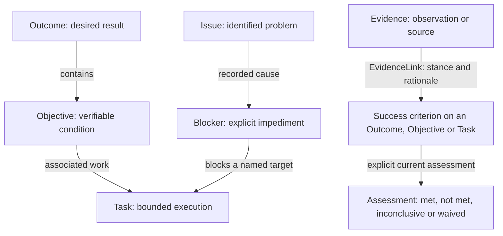

# Understand the work on an Outcome Board

An Outcome is the result you want. Objectives describe conditions that make
that result possible; Tasks record the work people and agents perform.
Evidence records what was observed. Issues explain problems, and Blockers
identify the work an impediment actually prevents.

For example, an Outcome could be **Customers can receive partial refunds**.
An Objective could be **Partial refunds are implemented and tested**, with a
criterion such as **A partial refund preserves the remaining refundable balance**.
A Task implements the endpoint. A test report is Evidence. An incorrect balance
is an Issue; it blocks the Objective only when an explicit Blocker records that
impact.

The arrows explain different relationships. They are not an automatic
completion pipeline. Completing a Task does not achieve its Objective;
achieving an Objective does not achieve its Outcome. Linking Evidence does
not assess a criterion. `waived` is explicitly not verified.

## Choose the relationship you mean

| You want to express | Use | What it means |
| --- | --- | --- |
| This condition is part of another condition | **Add objective** from an Objective; select **Parent Objective** | Decomposition in the same Outcome, without an implied execution dependency. |
| This Task contributes work to an Objective | **New task** from that Objective; review the **Objective** field | Explicit Task association. A Task may also belong directly to the Outcome. |
| This work needs something else first | **Add dependency** on a Task or Objective | A hard prerequisite affects readiness and completion. An advisory dependency records context without blocking transitions. |
| This observation supports or challenges a statement | **Link evidence** from Evidence | Select the target, stance (`supports`, `contradicts` or `context`) and rationale. Stance belongs to this individual EvidenceLink. |
| This criterion was evaluated | Select a success criterion and **Assess criterion** where permitted | Record a result for the current criterion revision, with rationale and the appropriate Evidence. |
| There is a problem with these items | **Report issue**; select **Affected items** | The Issue records problem scope. Association alone does not block work. |
| This problem actually prevents work | **Report issue and block work**, or **Mark work as blocked** | An explicit Blocker records one target, its cause and propagation. |
| The problem is fixed and certain blocked targets can continue | **Resolve issue and release selected blockers** | Resolve the Issue and explicitly select the blocking impacts to release. |
| There is a material deliverable or a recorded choice | **Register artifact** or **Propose decision** | Preserve a reference to a deliverable or an explicit choice and rationale. Neither implies verification or execution authority. |

The available actions depend on your permissions, the current lifecycle and
the instance's execution protocol. The server validates every submitted
operation. A missing action is not a reason to bypass that validation.

## Read a selected item

**How this fits together** explains the selected entity's role and recorded
placement. An Objective shows its parent when present. A Task identifies its
Objective or says that it belongs directly to the Outcome. Scope and membership
are separate from dependency and completion.

Connection groups distinguish Objectives and Tasks, dependencies, Evidence,
problems and blocking, and documentary sources. References open the related
record. An **Inspect link** control opens the actual persisted relationship;
it is useful when you need its rationale, version or other details. Longer
groups use a disclosure to retain all loaded connections without stretching
the initial inspector.

Task inspection keeps its authoritative focal context for operational detail,
including current attention, dependencies, inherited blocking and Evidence.
Its membership appears once rather than repeating the same hierarchy in two
competing summaries. Outside the Board, entity details explain direct recorded
references and identify that the loaded Board connection index is not included.

- **Depends on** points from the selected work to its prerequisite.
  **Required by** points to work that references the selected item.
  An unknown dependency strength is reported as unknown.
- Evidence labels keep the stance of each individual EvidenceLink visible.
  The same Evidence may support one target and contradict another. A criterion
  reference identifies the statement involved; it does not say it passed.
- **Affected item** describes an Issue's recorded scope. **Direct Blocker**
  identifies an actual impediment link. The Task's authoritative blocking and
  attention sections explain inherited blocking, current readiness and review.
- A resolved Issue can remain the cause of an active Blocker. Confirm that
  the impediment has been removed before releasing it. Resolving the Issue
  alone does not release its Blockers.

Only persisted ownership and Objective hierarchy position work in the tree.
Moving notes or changing the map's local arrangement does not change that
ownership. Roadmap grouping and order describe a plan, not operational
dependencies.

## Follow one result from planning to acceptance

1. Create the Outcome and describe the desired result. Add its required success
   criteria before activation.
2. Add an Objective for a verifiable intermediate condition. Mark
   **Required for Outcome** only when achieving that Objective must be a gate
   for the Outcome. Define the Objective's own criteria.
3. From the Objective, choose **New task** and review its preselected Objective.
   Add concrete instructions and deliverables. Add an explicit dependency only
   when prerequisite work is actually required.
4. Activate the Outcome when preparation is ready. Use the Task's current
   execution controls or CLI handoff to acquire bounded authority, perform
   the work externally and submit the delivery. Execution and independent
   review follow the instance's protocol; the browser does not sign on behalf
   of an agent.
5. Register the test observation as Evidence. Link it to the relevant target
   with the appropriate stance and rationale. Review the criterion separately;
   attaching a report does not approve it.
6. Investigate Issues and confirm removal of any blocking impacts. Review
   current required criteria, dependencies and obligations. Explicitly
   **Certify objective** and, when its own gates are satisfied,
   **Certify outcome**. Task progress percentages are not acceptance decisions.

The canonical domain can achieve a qualifying Objective directly from its
planned state; the current human action menu exposes **Certify objective**
after **Start objective**. This guide describes the visible workspace rather
than promising every API transition is a separate browser control.

## Understand what is loaded

The Board is a bounded view of persistent state, not the entire database.
**Load more** retrieves additional available pages. Search and specialist views
help investigate records beyond the currently visible notes. Expanding a
branch or inspecting a Task can add context, while retaining a consistent
Outcome revision.

**Loaded connections and coverage** states the source and limits of the
inspector summary. It uses only loaded Board edges and references recorded on
the selected item. Missing connections do not prove that there are no Issues,
dependencies or Evidence; they do not establish readiness or acceptance.
Direct references remain inspectable even when a related note's details are
not yet loaded. If another actor changes the Outcome while context is loading,
refresh rather than combining different revisions.

For navigation, execution authority and uncertain-response recovery, see
[the human workspace guide](workspace-ux.md). For the domain's precise source
of truth, see [the canonical architecture](WOS_Design_Arquitetura_Planejamento_Atualizado.md).
